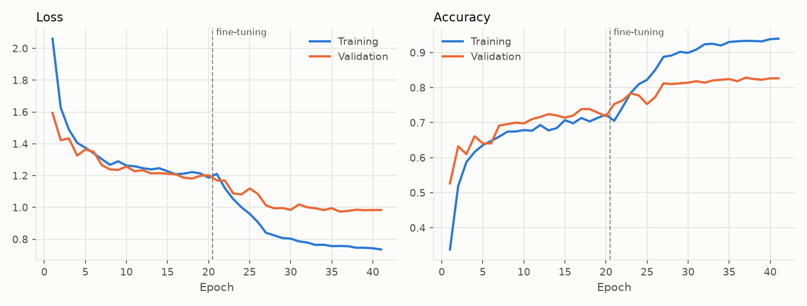
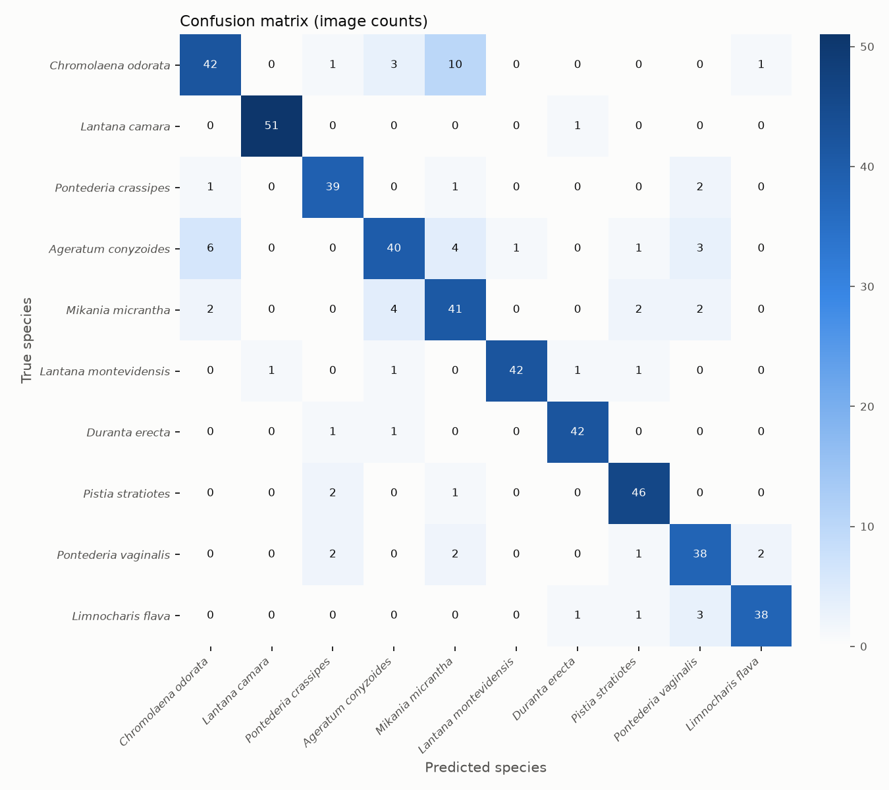
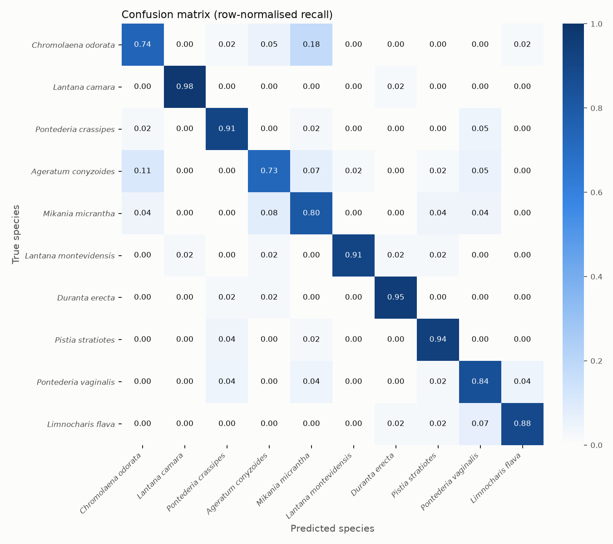
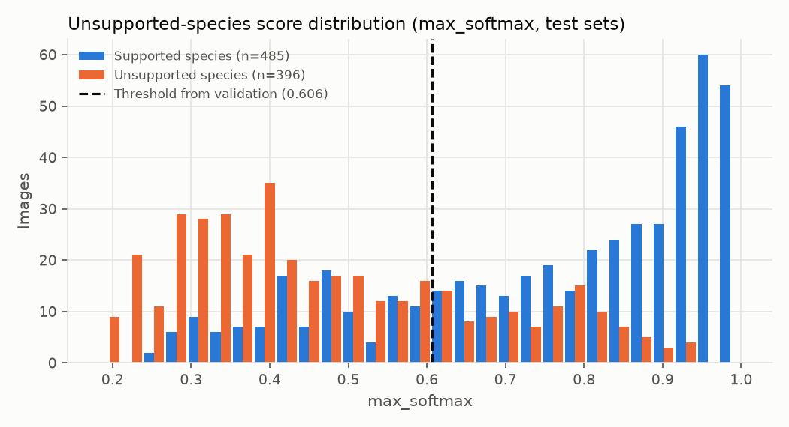
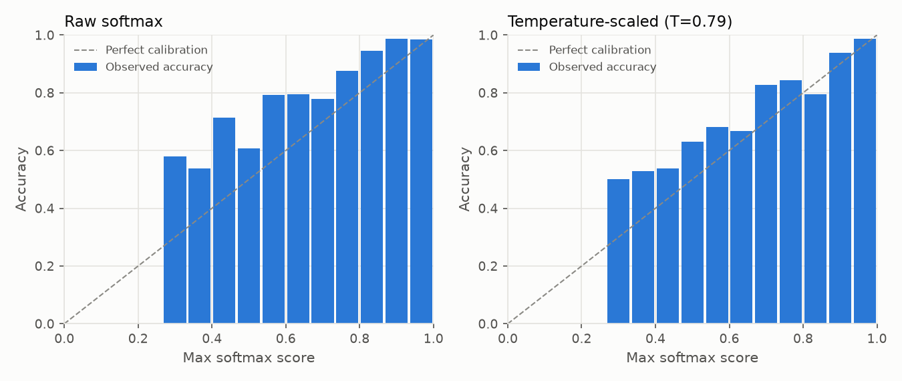

# Research Evaluation Report - run-20261104T152356Z-tenclass-v2

*Generated 2026-11-04T15:52:39+00:00 from run artifacts in `models/checkpoints/expansion/run-20261104T152356Z-tenclass-v2`. Dataset version `ds-20261104-6529c8c7f1`. This model is a research candidate: it has not been deployed or activated in GeoFlora.*

## 1. Summary of observed results

- Classes: 10 (*Chromolaena odorata*, *Lantana camara*, *Pontederia crassipes*, *Ageratum conyzoides*, *Mikania micrantha*, *Lantana montevidensis*, *Duranta erecta*, *Pistia stratiotes*, *Pontederia vaginalis*, *Limnocharis flava*)
- Independent test images: 485 from 449 observation groups
- Test accuracy: **86.4%** (95% exact binomial CI 83.0% - 89.3%; observation-group bootstrap CI 83.0% - 89.4%)
- Macro F1: **0.868** (CI 0.836 - 0.894); weighted F1: 0.864
- Unsupported-species false acceptance: 100% without rejection (closed-set softmax); **26.0%** with the validation-selected threshold, at a supported-species acceptance rate of 75.7%. AUROC 0.834.
- Forward-pass latency (batch 1, median): 20.5 ms on CPU; model file 25.9 MB.

Targets such as a specific accuracy level are only met if the figures above show it on this independent test set.

## 2. Dataset sources and selection criteria

- Source(s): GBIF; source datasets: iNaturalist research-grade observations (3230); unspecified (2)
- Licenses used: CC-BY-NC-4.0: 2845, CC-BY-4.0: 301, CC0-1.0: 86
- Country of record (top): PH: 908, TW: 458, US: 338, AU: 274, IN: 181, TH: 97, ID: 81, BR: 73
- Selection criteria: still images with an allowed per-image license, basis of record ['HUMAN_OBSERVATION'], at most 1 image(s) per occurrence; quality checks (resolution, blur, exposure, aspect ratio); exact and perceptual duplicate removal; **photo-by-photo screening by a named non-botanist reviewer, starting from iNaturalist research-grade community identifications, with an AI-assisted pre-screen that flagged questionable photos for the reviewer's decision (not expert botanical verification)**.
- Label reviewer(s): Reyca de Alba (3232 images)
- These photographs are external biodiversity records, not GeoFlora field observations.

## 3. Target species and ecological-status evidence

| Index | Species ID | Scientific name | Ecological status | Verification | Evidence |
|---|---|---|---|---|---|
| 0 | GF-SP-0001 | *Chromolaena odorata* | target_invasive | unverified | Recognised by the existing GeoFlora active CNN (client scope). Listed in IUCN SSC ISSG '100 of the World's Worst Invasive Alien Species' (Lowe et al. 2000) - global evidence only. Philippine-specific citation still to be supplied by the client/botanist. / Philippines: DENR-BMB National Invasive Species Strategy and Action Plan (NISSAP) 2020-2030, p. 9 (most noxious invasive plants) and Box 2.1 (https://www.philchm.ph/wp-content/uploads/2024/01/NISSAP-2020-2030.pdf). Citation added 2026-11-04; not yet checked by a named verifier. |
| 1 | GF-SP-0002 | *Lantana camara* | target_invasive | unverified | Recognised by the existing GeoFlora active CNN (client scope). Listed in IUCN SSC ISSG '100 of the World's Worst Invasive Alien Species' (Lowe et al. 2000) - global evidence only. Philippine-specific citation still to be supplied by the client/botanist. / Philippines: DENR-BMB National Invasive Species Strategy and Action Plan (NISSAP) 2020-2030, p. 9 and Box 2.1 (https://www.philchm.ph/wp-content/uploads/2024/01/NISSAP-2020-2030.pdf). Citation added 2026-11-04; not yet checked by a named verifier. |
| 2 | GF-SP-0003 | *Pontederia crassipes* | target_invasive | unverified | Recognised by the existing GeoFlora active CNN (client scope). Listed in IUCN SSC ISSG '100 of the World's Worst Invasive Alien Species' as Eichhornia crassipes (Lowe et al. 2000) - global evidence only. Philippine-specific citation still to be supplied by the client/botanist. / Philippines: DENR-BMB National Invasive Species Strategy and Action Plan (NISSAP) 2020-2030, p. 9 and Box 2.1 (as Eichhornia crassipes) (https://www.philchm.ph/wp-content/uploads/2024/01/NISSAP-2020-2030.pdf). Citation added 2026-11-04; not yet checked by a named verifier. |
| 3 | GF-SP-0101 | *Ageratum conyzoides* | unresolved | unverified | none recorded |
| 4 | GF-SP-0102 | *Mikania micrantha* | unresolved | unverified | Listed in IUCN SSC ISSG '100 of the World's Worst Invasive Alien Species' (global evidence only). / Philippines: DENR-BMB National Invasive Species Strategy and Action Plan (NISSAP) 2020-2030, Box 2.1 (https://www.philchm.ph/wp-content/uploads/2024/01/NISSAP-2020-2030.pdf). Citation added 2026-11-04; not yet checked by a named verifier. |
| 5 | GF-SP-0103 | *Lantana montevidensis* | unresolved | unverified | none recorded |
| 6 | GF-SP-0104 | *Duranta erecta* | unresolved | unverified | none recorded |
| 7 | GF-SP-0105 | *Pistia stratiotes* | unresolved | unverified | none recorded |
| 8 | GF-SP-0106 | *Pontederia vaginalis* | unresolved | unverified | none recorded |
| 9 | GF-SP-0107 | *Limnocharis flava* | unresolved | unverified | none recorded |

## 4. Images and independent observation groups per class

| Species | Train imgs / groups | Val imgs / groups | Test imgs / groups |
|---|---|---|---|
| *Chromolaena odorata* | 262 / 245 | 57 / 52 | 57 / 52 |
| *Lantana camara* | 243 / 218 | 53 / 47 | 52 / 46 |
| *Pontederia crassipes* | 199 / 188 | 43 / 40 | 43 / 36 |
| *Ageratum conyzoides* | 257 / 244 | 56 / 53 | 55 / 51 |
| *Mikania micrantha* | 235 / 217 | 51 / 49 | 51 / 48 |
| *Lantana montevidensis* | 215 / 201 | 46 / 42 | 46 / 44 |
| *Duranta erecta* | 206 / 197 | 44 / 43 | 44 / 42 |
| *Pistia stratiotes* | 228 / 198 | 49 / 44 | 49 / 46 |
| *Pontederia vaginalis* | 211 / 193 | 46 / 42 | 45 / 41 |
| *Limnocharis flava* | 201 / 194 | 45 / 44 | 43 / 43 |

## 5. Preprocessing

EXIF orientation applied, converted to RGB, re-encoded as JPEG (max side 1024 px), resized to 224x224 (bilinear, aspect ratio not preserved), float32 in [0, 255]; MobileNetV2 scaling to [-1, 1] inside the model.
Training augmentation: {'horizontal_flip': True, 'rotation': 0.08, 'zoom': 0.15, 'translation': 0.1, 'contrast': 0.2, 'brightness': 0.2}.

## 6. Training configuration and architecture

- Architecture: MobileNetV2, ImageNet-pretrained, alpha=1.0 -> GlobalAveragePooling -> Dropout(0.3) -> Dense(10, softmax). Parameters: 2,270,794.
- Phase 1 (frozen base): up to 20 epochs, Adam lr=0.001.
- Phase 2 (fine-tuning layers >= 80, BatchNorm frozen): up to 30 epochs, Adam lr=3e-05. Selected phase: **finetune** (lowest validation loss).
- Early stopping (patience 5), ReduceLROnPlateau, checkpointing on validation loss; batch size 16; seed 42; class weights: none.
- Epochs run: 41; training time 1684.7 s.

## 7. Train / validation / test methodology

Images were partitioned by observation group (same occurrence, exact duplicates, perceptual near-duplicates [pHash Hamming <= 6], and same recorder on the same day) with target ratios {'train': 0.7, 'val': 0.15, 'test': 0.15}. Assignments are sticky across dataset versions so test images never enter training. Model selection and the unsupported-species threshold used validation data only; the test and unknown_test sets were used once, for this report.

## 8. Evaluation results (test set)

Validation (for reference): accuracy 81.8%, macro F1 0.820.

| Species | Precision | Recall | F1 | Support |
|---|---|---|---|---|
| *Chromolaena odorata* | 0.824 | 0.737 | 0.778 | 57 |
| *Lantana camara* | 0.981 | 0.981 | 0.981 | 52 |
| *Pontederia crassipes* | 0.867 | 0.907 | 0.886 | 43 |
| *Ageratum conyzoides* | 0.816 | 0.727 | 0.769 | 55 |
| *Mikania micrantha* | 0.695 | 0.804 | 0.745 | 51 |
| *Lantana montevidensis* | 0.977 | 0.913 | 0.944 | 46 |
| *Duranta erecta* | 0.933 | 0.955 | 0.944 | 44 |
| *Pistia stratiotes* | 0.885 | 0.939 | 0.911 | 49 |
| *Pontederia vaginalis* | 0.792 | 0.844 | 0.817 | 45 |
| *Limnocharis flava* | 0.927 | 0.884 | 0.905 | 43 |
| **Macro** | 0.870 | 0.869 | 0.868 | 485 |

Top 3 accuracy: 97.5%.

## 9. Confusion matrix

 

Most frequent confusions (true -> predicted): *Chromolaena odorata* -> *Mikania micrantha* (10); *Ageratum conyzoides* -> *Chromolaena odorata* (6); *Mikania micrantha* -> *Ageratum conyzoides* (4); *Ageratum conyzoides* -> *Mikania micrantha* (4); *Limnocharis flava* -> *Pontederia vaginalis* (3); *Chromolaena odorata* -> *Ageratum conyzoides* (3); *Ageratum conyzoides* -> *Pontederia vaginalis* (3); *Pontederia vaginalis* -> *Pontederia crassipes* (2); *Pontederia vaginalis* -> *Mikania micrantha* (2); *Pontederia vaginalis* -> *Limnocharis flava* (2)

## 10. False-positive and false-negative analysis

| Species | TP | FN | FP | FN predicted as | FP true species | Mean score correct / incorrect |
|---|---|---|---|---|---|---|
| *Chromolaena odorata* | 42 | 15 | 9 | {'Mikania micrantha': 10, 'Ageratum conyzoides': 3, 'Pontederia crassipes': 1, 'Limnocharis flava': 1} | {'Ageratum conyzoides': 6, 'Mikania micrantha': 2, 'Pontederia crassipes': 1} | 0.809 / 0.533 |
| *Lantana camara* | 51 | 1 | 1 | {'Duranta erecta': 1} | {'Lantana montevidensis': 1} | 0.870 / 0.768 |
| *Pontederia crassipes* | 39 | 4 | 6 | {'Pontederia vaginalis': 2, 'Chromolaena odorata': 1, 'Mikania micrantha': 1} | {'Pistia stratiotes': 2, 'Pontederia vaginalis': 2, 'Chromolaena odorata': 1, 'Duranta erecta': 1} | 0.822 / 0.452 |
| *Ageratum conyzoides* | 40 | 15 | 9 | {'Chromolaena odorata': 6, 'Mikania micrantha': 4, 'Pontederia vaginalis': 3, 'Lantana montevidensis': 1, 'Pistia stratiotes': 1} | {'Mikania micrantha': 4, 'Chromolaena odorata': 3, 'Lantana montevidensis': 1, 'Duranta erecta': 1} | 0.674 / 0.621 |
| *Mikania micrantha* | 41 | 10 | 18 | {'Ageratum conyzoides': 4, 'Pistia stratiotes': 2, 'Chromolaena odorata': 2, 'Pontederia vaginalis': 2} | {'Chromolaena odorata': 10, 'Ageratum conyzoides': 4, 'Pontederia vaginalis': 2, 'Pontederia crassipes': 1, 'Pistia stratiotes': 1} | 0.788 / 0.483 |
| *Lantana montevidensis* | 42 | 4 | 1 | {'Duranta erecta': 1, 'Pistia stratiotes': 1, 'Ageratum conyzoides': 1, 'Lantana camara': 1} | {'Ageratum conyzoides': 1} | 0.745 / 0.419 |
| *Duranta erecta* | 42 | 2 | 3 | {'Ageratum conyzoides': 1, 'Pontederia crassipes': 1} | {'Lantana camara': 1, 'Lantana montevidensis': 1, 'Limnocharis flava': 1} | 0.837 / 0.626 |
| *Pistia stratiotes* | 46 | 3 | 6 | {'Pontederia crassipes': 2, 'Mikania micrantha': 1} | {'Mikania micrantha': 2, 'Ageratum conyzoides': 1, 'Lantana montevidensis': 1, 'Pontederia vaginalis': 1, 'Limnocharis flava': 1} | 0.842 / 0.601 |
| *Pontederia vaginalis* | 38 | 7 | 10 | {'Mikania micrantha': 2, 'Limnocharis flava': 2, 'Pontederia crassipes': 2, 'Pistia stratiotes': 1} | {'Ageratum conyzoides': 3, 'Limnocharis flava': 3, 'Pontederia crassipes': 2, 'Mikania micrantha': 2} | 0.705 / 0.522 |
| *Limnocharis flava* | 38 | 5 | 3 | {'Pontederia vaginalis': 3, 'Duranta erecta': 1, 'Pistia stratiotes': 1} | {'Pontederia vaginalis': 2, 'Chromolaena odorata': 1} | 0.809 / 0.536 |

Misclassified images with attribution: `misclassified_test_images.csv`.

## 11. Unsupported-species evaluation

- Score: `max_softmax`; threshold strategy `youden` -> threshold 0.6062 (selected on validation (val + unknown_val); test sets not used).
- unknown_val species (threshold selection): Imperata cylindrica, Ixora coccinea, Mimosa pudica
- unknown_test species (final evaluation): Bidens pilosa, Hibiscus rosa-sinensis, Ipomoea aquatica
- Test: supported-species acceptance 75.7%, accuracy on accepted 93.5%; unsupported false acceptance 26.0% (n=396); AUROC 0.834.

| Unsupported species | Images | False acceptance (thresholded) | Labels assigned without rejection |
|---|---|---|---|
| *Bidens pilosa* | 121 | 40.5% | {'Lantana camara': 33, 'Ageratum conyzoides': 27, 'Chromolaena odorata': 20, 'Mikania micrantha': 17, 'Limnocharis flava': 7, 'Pontederia vaginalis': 5, 'Pontederia crassipes': 5, 'Duranta erecta': 3, 'Lantana montevidensis': 3, 'Pistia stratiotes': 1} |
| *Hibiscus rosa-sinensis* | 140 | 10.0% | {'Chromolaena odorata': 33, 'Lantana camara': 27, 'Pontederia crassipes': 22, 'Duranta erecta': 15, 'Lantana montevidensis': 12, 'Pistia stratiotes': 11, 'Limnocharis flava': 10, 'Pontederia vaginalis': 5, 'Ageratum conyzoides': 4, 'Mikania micrantha': 1} |
| *Ipomoea aquatica* | 135 | 29.6% | {'Pontederia vaginalis': 45, 'Chromolaena odorata': 28, 'Mikania micrantha': 23, 'Lantana montevidensis': 14, 'Pistia stratiotes': 8, 'Ageratum conyzoides': 7, 'Limnocharis flava': 5, 'Pontederia crassipes': 3, 'Duranta erecta': 1, 'Lantana camara': 1} |

Calibration: ECE 0.107 (raw softmax) and 0.049 after temperature scaling (T=0.79, fitted on validation). Softmax scores are model scores, not calibrated identification confidence.

## 12. Robustness and photographic conditions

Synthetic perturbations of the test images (these approximate, but are not, real lighting/angle/background changes):

| Perturbation | Accuracy | Macro F1 |
|---|---|---|
| none | 86.4% | 0.868 |
| darker_40pct | 79.2% | 0.796 |
| brighter_40pct | 80.8% | 0.810 |
| low_contrast | 72.0% | 0.726 |
| gaussian_blur | 70.7% | 0.715 |
| rotate_90 | 81.0% | 0.817 |
| jpeg_q20 | 75.3% | 0.744 |
| center_crop_60pct | 86.8% | 0.871 |

No reviewer condition tags (lighting, background, organ, growth stage) were available, so real-condition breakdowns were not computed.

## 13. Runtime and model size

Device CPU; batch-1 latency median 20.5 ms (p95 22.5 ms); batch-32 throughput 100.8 img/s; 2,270,794 parameters; `.keras` file 25.9 MB. Model forward pass only (excludes image decoding/resizing). Measured on this machine.

## 14. Model limitations (observed or inherent to this setup)

- Training and test images come from external biodiversity platforms; their photographers, devices and framing differ from GeoFlora users' photos, so field performance may differ from the figures above.
- Test-set size (485 images) bounds precision of the estimates; see the bootstrap confidence intervals.
- The model is closed-set: without the rejection threshold every unsupported plant receives a supported label.
- Softmax scores are not calibrated probabilities of a correct identification.
- 28.1% of the images used were recorded in the Philippines (country of record per source metadata).
- Ecological status is not yet verified with Philippine-specific evidence for: *Chromolaena odorata*, *Lantana camara*, *Pontederia crassipes*, *Ageratum conyzoides*, *Mikania micrantha*, *Lantana montevidensis*, *Duranta erecta*, *Pistia stratiotes*, *Pontederia vaginalis*, *Limnocharis flava*.
- Unsupported-species evaluation covers only 3 species; false-acceptance rates for other plants are unknown.
- Aspect ratio is not preserved during resizing, which may distort plant morphology.

## 15. Reproducibility

- Run directory: `models/checkpoints/expansion/run-20261104T152356Z-tenclass-v2` (contains run_config.yaml, class_mapping.json, train/val/test image lists, history, logs).
- Dataset version `ds-20261104-6529c8c7f1`; image lists for each split are stored with the run.
- Seed 42; deterministic ops: False.
- Environment: Python 3.11.9, TensorFlow 2.20.0, Keras 3.15.1, Windows-10-10.0.26200-SP0, GPUs: none.
- Re-run: `python scripts/train.py --config <run_config.yaml>` then `python scripts/evaluate.py --run <run_dir>`.

## 16. Proposed future improvements (not yet tested)

- Collect and review more diverse images of *Mikania micrantha* (test F1 0.745).
- Collect and review more diverse images of *Ageratum conyzoides* (test F1 0.769).
- Collect and review more diverse images of *Chromolaena odorata* (test F1 0.778).
- Add targeted reviewed images that separate *Chromolaena odorata* from *Mikania micrantha* (10 confusions observed).
- Add targeted reviewed images that separate *Ageratum conyzoides* from *Chromolaena odorata* (6 confusions observed).
- Add targeted reviewed images that separate *Mikania micrantha* from *Ageratum conyzoides* (4 confusions observed).
- Collect GeoFlora-style field photographs from the Philippines (with consent and botanist verification) as an additional held-out test set.
- Expand the unsupported-species set with more look-alike and common non-target plants to tighten false-acceptance estimates.
- Evaluate alternative rejection methods (e.g. energy scores from logits, feature-space distance) on the same validation protocol.
- Ask reviewers to tag photographic conditions so that real-condition robustness can be measured.

