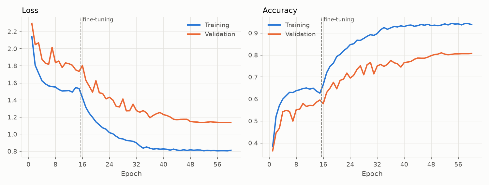
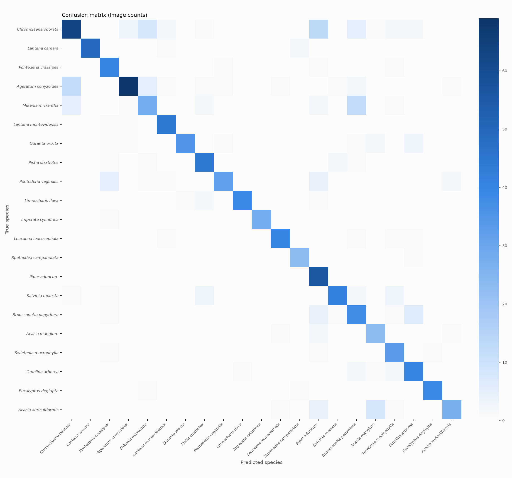
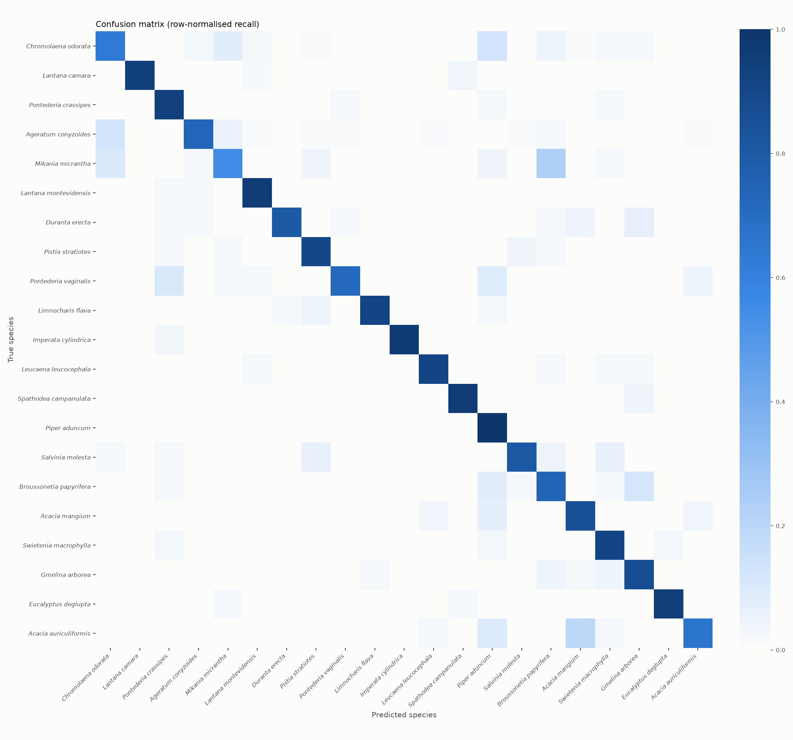
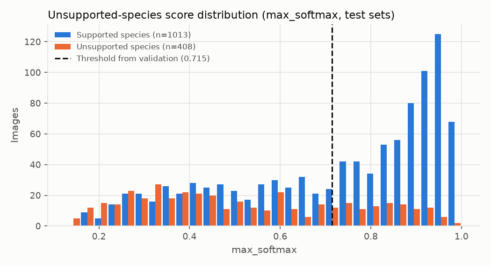
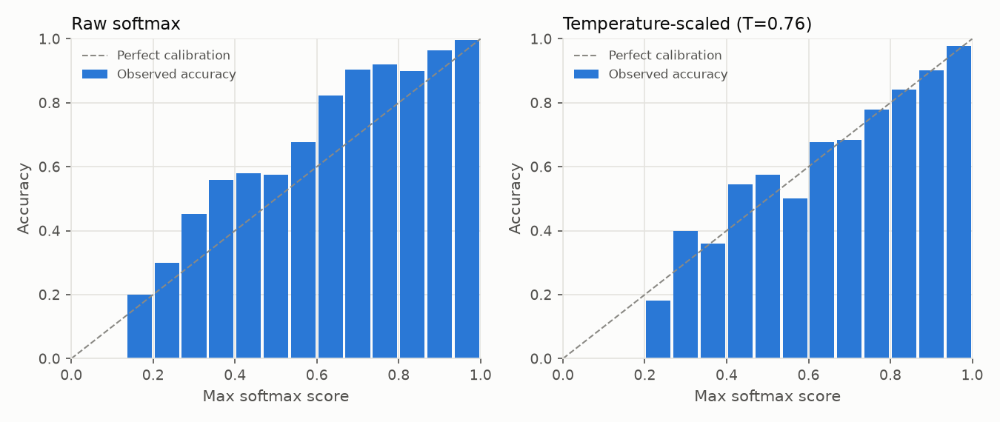

# Research Evaluation Report - run-20261105T180911Z-nissap21-v3-hagonoy-ageratum

*Generated 2026-11-06T07:22:27+00:00 from run artifacts in `models/checkpoints/nissap/run-20261105T180911Z-nissap21-v3-hagonoy-ageratum`. Dataset version `ds-20261105-4de0c37cb5`. This model is a research candidate: it has not been deployed or activated in GeoFlora.*

## 1. Summary of observed results

- Classes: 21 (*Chromolaena odorata*, *Lantana camara*, *Pontederia crassipes*, *Ageratum conyzoides*, *Mikania micrantha*, *Lantana montevidensis*, *Duranta erecta*, *Pistia stratiotes*, *Pontederia vaginalis*, *Limnocharis flava*, *Imperata cylindrica*, *Leucaena leucocephala*, *Spathodea campanulata*, *Piper aduncum*, *Salvinia molesta*, *Broussonetia papyrifera*, *Acacia mangium*, *Swietenia macrophylla*, *Gmelina arborea*, *Eucalyptus deglupta*, *Acacia auriculiformis*)
- Independent test images: 1013 from 935 observation groups
- Test accuracy: **82.0%** (95% exact binomial CI 79.5% - 84.4%; observation-group bootstrap CI 79.7% - 84.2%)
- Macro F1: **0.833** (CI 0.810 - 0.854); weighted F1: 0.820
- Unsupported-species false acceptance: 100% without rejection (closed-set softmax); **26.5%** with the validation-selected threshold, at a supported-species acceptance rate of 60.4%. AUROC 0.738.
- Forward-pass latency (batch 1, median): 34.1 ms on CPU; model file 27.36 MB.

Targets such as a specific accuracy level are only met if the figures above show it on this independent test set.

## 2. Dataset sources and selection criteria

- Source(s): GBIF, GeoFlora app; source datasets: iNaturalist research-grade observations (6728); unspecified (7); GeoFlora field reports (2)
- Licenses used: CC-BY-NC-4.0: 5953, CC-BY-4.0: 625, CC0-1.0: 157, GEOFLORA-CONTRIBUTOR: 2
- Country of record (top): PH: 1379, TW: 982, US: 810, AU: 563, IN: 404, BR: 177, ID: 176, ZA: 174
- Selection criteria: still images with an allowed per-image license, basis of record ['HUMAN_OBSERVATION'], at most 1 image(s) per occurrence; quality checks (resolution, blur, exposure, aspect ratio); exact and perceptual duplicate removal; **photo-by-photo screening by a named non-botanist reviewer, starting from iNaturalist research-grade community identifications, with an AI-assisted pre-screen that flagged questionable photos for the reviewer's decision (not expert botanical verification)**.
- Label reviewer(s): Reyca de Alba (6735 images), GeoFlora AI reviewer (2 images)
- These photographs are external biodiversity records, not GeoFlora field observations.

## 3. Target species and ecological-status evidence

| Index | Species ID | Scientific name | Ecological status | Verification | Evidence |
|---|---|---|---|---|---|
| 0 | GF-SP-0001 | *Chromolaena odorata* | target_invasive | verified | Recognised by the existing GeoFlora active CNN (client scope). Listed in IUCN SSC ISSG '100 of the World's Worst Invasive Alien Species' (Lowe et al. 2000) - global evidence only. Philippine-specific citation still to be supplied by the client/botanist. / Philippines: DENR-BMB National Invasive Species Strategy and Action Plan (NISSAP) 2020-2030, p. 9 (most noxious invasive plants) and Box 2.1 (https://www.philchm.ph/wp-content/uploads/2024/01/NISSAP-2020-2030.pdf). Citation added 2026-11-04; not yet checked by a named verifier. |
| 1 | GF-SP-0002 | *Lantana camara* | target_invasive | verified | Recognised by the existing GeoFlora active CNN (client scope). Listed in IUCN SSC ISSG '100 of the World's Worst Invasive Alien Species' (Lowe et al. 2000) - global evidence only. Philippine-specific citation still to be supplied by the client/botanist. / Philippines: DENR-BMB National Invasive Species Strategy and Action Plan (NISSAP) 2020-2030, p. 9 and Box 2.1 (https://www.philchm.ph/wp-content/uploads/2024/01/NISSAP-2020-2030.pdf). Citation added 2026-11-04; not yet checked by a named verifier. |
| 2 | GF-SP-0003 | *Pontederia crassipes* | target_invasive | verified | Recognised by the existing GeoFlora active CNN (client scope). Listed in IUCN SSC ISSG '100 of the World's Worst Invasive Alien Species' as Eichhornia crassipes (Lowe et al. 2000) - global evidence only. Philippine-specific citation still to be supplied by the client/botanist. / Philippines: DENR-BMB National Invasive Species Strategy and Action Plan (NISSAP) 2020-2030, p. 9 and Box 2.1 (as Eichhornia crassipes) (https://www.philchm.ph/wp-content/uploads/2024/01/NISSAP-2020-2030.pdf). Citation added 2026-11-04; not yet checked by a named verifier. |
| 3 | GF-SP-0101 | *Ageratum conyzoides* | unresolved | unverified | none recorded |
| 4 | GF-SP-0102 | *Mikania micrantha* | target_invasive | verified | Listed in IUCN SSC ISSG '100 of the World's Worst Invasive Alien Species' (global evidence only). / Philippines: DENR-BMB National Invasive Species Strategy and Action Plan (NISSAP) 2020-2030, Box 2.1 (https://www.philchm.ph/wp-content/uploads/2024/01/NISSAP-2020-2030.pdf). Citation added 2026-11-04; not yet checked by a named verifier. |
| 5 | GF-SP-0103 | *Lantana montevidensis* | unresolved | unverified | none recorded |
| 6 | GF-SP-0104 | *Duranta erecta* | unresolved | unverified | none recorded |
| 7 | GF-SP-0105 | *Pistia stratiotes* | unresolved | unverified | none recorded |
| 8 | GF-SP-0106 | *Pontederia vaginalis* | unresolved | unverified | none recorded |
| 9 | GF-SP-0107 | *Limnocharis flava* | unresolved | unverified | none recorded |
| 10 | GF-SP-0206 | *Imperata cylindrica* | target_invasive | verified | Listed in IUCN SSC ISSG '100 of the World's Worst Invasive Alien Species' but generally regarded as native in tropical Asia. Illustrates why global invasive lists cannot be used as Philippine status evidence. / Philippines: DENR-BMB National Invasive Species Strategy and Action Plan (NISSAP) 2020-2030, p. 9 (notes some botanists consider it naturalized) (https://www.philchm.ph/wp-content/uploads/2024/01/NISSAP-2020-2030.pdf). Citation added 2026-11-04; not yet checked by a named verifier. |
| 11 | GF-SP-0303 | *Leucaena leucocephala* | target_invasive | verified | Listed in IUCN SSC ISSG '100 of the World's Worst Invasive Alien Species' (global evidence only). / Philippines: DENR-BMB National Invasive Species Strategy and Action Plan (NISSAP) 2020-2030, Box 2.1 and Table 3.2 (https://www.philchm.ph/wp-content/uploads/2024/01/NISSAP-2020-2030.pdf). Citation added 2026-11-04; not yet checked by a named verifier. |
| 12 | GF-SP-0304 | *Spathodea campanulata* | target_invasive | verified | Listed in IUCN SSC ISSG '100 of the World's Worst Invasive Alien Species' (global evidence only). / Philippines: DENR-BMB National Invasive Species Strategy and Action Plan (NISSAP) 2020-2030, Box 2.1 and Fig. 2.5 (https://www.philchm.ph/wp-content/uploads/2024/01/NISSAP-2020-2030.pdf). Citation added 2026-11-04; not yet checked by a named verifier. |
| 13 | GF-SP-0305 | *Piper aduncum* | target_invasive | verified | Listed in IUCN SSC ISSG '100 of the World's Worst Invasive Alien Species' (global evidence only). / Philippines: DENR-BMB National Invasive Species Strategy and Action Plan (NISSAP) 2020-2030, Box 2.1 and Fig. 2.4 (https://www.philchm.ph/wp-content/uploads/2024/01/NISSAP-2020-2030.pdf). Citation added 2026-11-04; not yet checked by a named verifier. |
| 14 | GF-SP-0308 | *Salvinia molesta* | target_invasive | verified | Listed in IUCN SSC ISSG '100 of the World's Worst Invasive Alien Species' (global evidence only). / Philippines: DENR-BMB National Invasive Species Strategy and Action Plan (NISSAP) 2020-2030, p. 9 and Box 2.1 (https://www.philchm.ph/wp-content/uploads/2024/01/NISSAP-2020-2030.pdf). Citation added 2026-11-04; not yet checked by a named verifier. |
| 15 | GF-SP-0311 | *Broussonetia papyrifera* | target_invasive | verified | Philippines: DENR-BMB National Invasive Species Strategy and Action Plan (NISSAP) 2020-2030, Box 2.1 and Table 3.2 (https://www.philchm.ph/wp-content/uploads/2024/01/NISSAP-2020-2030.pdf). Citation added 2026-11-04; not yet checked by a named verifier. |
| 16 | GF-SP-0312 | *Acacia mangium* | target_invasive | verified | Philippines: DENR-BMB National Invasive Species Strategy and Action Plan (NISSAP) 2020-2030, Box 2.1 and Table 3.2 (https://www.philchm.ph/wp-content/uploads/2024/01/NISSAP-2020-2030.pdf). Citation added 2026-11-04; not yet checked by a named verifier. |
| 17 | GF-SP-0313 | *Swietenia macrophylla* | target_invasive | verified | Philippines: DENR-BMB National Invasive Species Strategy and Action Plan (NISSAP) 2020-2030, p. 9 and Table 3.2 (reforestation species) (https://www.philchm.ph/wp-content/uploads/2024/01/NISSAP-2020-2030.pdf). Citation added 2026-11-04; not yet checked by a named verifier. |
| 18 | GF-SP-0314 | *Gmelina arborea* | target_invasive | verified | Philippines: DENR-BMB National Invasive Species Strategy and Action Plan (NISSAP) 2020-2030, p. 9 and Table 3.2 (reforestation species) (https://www.philchm.ph/wp-content/uploads/2024/01/NISSAP-2020-2030.pdf). Citation added 2026-11-04; not yet checked by a named verifier. |
| 19 | GF-SP-0315 | *Eucalyptus deglupta* | unresolved | unverified | Philippines: DENR-BMB National Invasive Species Strategy and Action Plan (NISSAP) 2020-2030, p. 9 and Table 3.2 (as Eucalyptus spp.) (https://www.philchm.ph/wp-content/uploads/2024/01/NISSAP-2020-2030.pdf). Citation added 2026-11-04; not yet checked by a named verifier. |
| 20 | GF-SP-0316 | *Acacia auriculiformis* | unresolved | unverified | Philippines: DENR-BMB National Invasive Species Strategy and Action Plan (NISSAP) 2020-2030, p. 9 (reforestation species) (https://www.philchm.ph/wp-content/uploads/2024/01/NISSAP-2020-2030.pdf). Citation added 2026-11-04; not yet checked by a named verifier. |

## 4. Images and independent observation groups per class

| Species | Train imgs / groups | Val imgs / groups | Test imgs / groups |
|---|---|---|---|
| *Chromolaena odorata* | 467 / 424 | 101 / 94 | 100 / 88 |
| *Lantana camara* | 243 / 218 | 53 / 47 | 52 / 46 |
| *Pontederia crassipes* | 199 / 188 | 43 / 40 | 43 / 36 |
| *Ageratum conyzoides* | 436 / 414 | 94 / 89 | 94 / 89 |
| *Mikania micrantha* | 235 / 217 | 51 / 49 | 51 / 48 |
| *Lantana montevidensis* | 215 / 201 | 46 / 42 | 46 / 44 |
| *Duranta erecta* | 206 / 197 | 44 / 43 | 44 / 42 |
| *Pistia stratiotes* | 228 / 198 | 49 / 44 | 49 / 46 |
| *Pontederia vaginalis* | 211 / 193 | 46 / 42 | 45 / 41 |
| *Limnocharis flava* | 201 / 194 | 45 / 44 | 43 / 43 |
| *Imperata cylindrica* | 136 / 130 | 29 / 29 | 29 / 28 |
| *Leucaena leucocephala* | 203 / 191 | 44 / 42 | 44 / 42 |
| *Spathodea campanulata* | 110 / 109 | 24 / 23 | 24 / 21 |
| *Piper aduncum* | 260 / 245 | 56 / 50 | 56 / 55 |
| *Salvinia molesta* | 235 / 216 | 51 / 46 | 51 / 40 |
| *Broussonetia papyrifera* | 235 / 205 | 51 / 48 | 51 / 42 |
| *Acacia mangium* | 124 / 106 | 30 / 24 | 27 / 26 |
| *Swietenia macrophylla* | 165 / 141 | 36 / 36 | 36 / 33 |
| *Gmelina arborea* | 212 / 202 | 46 / 45 | 46 / 45 |
| *Eucalyptus deglupta* | 192 / 190 | 41 / 41 | 41 / 40 |
| *Acacia auriculiformis* | 190 / 153 | 41 / 40 | 41 / 40 |

## 5. Preprocessing

EXIF orientation applied, converted to RGB, re-encoded as JPEG (max side 1024 px), resized to 224x224 (bilinear, aspect ratio not preserved), float32 in [0, 255]; MobileNetV2 scaling to [-1, 1] inside the model.
Training augmentation: {'horizontal_flip': True, 'rotation': 0.15, 'zoom': 0.25, 'translation': 0.15, 'contrast': 0.3, 'brightness': 0.3}.

## 6. Training configuration and architecture

- Architecture: MobileNetV2, ImageNet-pretrained, alpha=1.0 -> GlobalAveragePooling -> Dropout(0.3) -> Dense(21, softmax). Parameters: 2,284,885.
- Phase 1 (frozen base): up to 15 epochs, Adam lr=0.001.
- Phase 2 (fine-tuning layers >= 30, BatchNorm frozen): up to 45 epochs, Adam lr=3e-05. Selected phase: **finetune** (lowest validation loss).
- Early stopping (patience 7), ReduceLROnPlateau, checkpointing on validation loss; batch size 16; seed 42; class weights: {'0': 0.47955541959824616, '1': 0.9216147364295513, '2': 1.1253888490069395, '3': 0.513652249890782, '4': 0.9529888551165147, '5': 1.0416389811738649, '6': 1.0871474803513639, '7': 0.9822472848788638, '8': 1.0613856917174453, '9': 1.1141909500118454, '10': 1.6467086834733893, '11': 1.1032136992728125, '12': 2.035930735930736, '13': 0.8613553113553114, '14': 0.9529888551165147, '15': 0.9529888551165147, '16': 1.806067588325653, '17': 1.3572871572871572, '18': 1.056379155435759, '19': 1.1664186507936507, '20': 1.1786967418546366}.
- Epochs run: 60; training time 47527.6 s.

## 7. Train / validation / test methodology

Images were partitioned by observation group (same occurrence, exact duplicates, perceptual near-duplicates [pHash Hamming <= 6], and same recorder on the same day) with target ratios {'train': 0.7, 'val': 0.15, 'test': 0.15}. Assignments are sticky across dataset versions so test images never enter training. Model selection and the unsupported-species threshold used validation data only; the test and unknown_test sets were used once, for this report.

## 8. Evaluation results (test set)

Validation (for reference): accuracy 80.7%, macro F1 0.811.

| Species | Precision | Recall | F1 | Support |
|---|---|---|---|---|
| *Chromolaena odorata* | 0.778 | 0.630 | 0.696 | 100 |
| *Lantana camara* | 1.000 | 0.942 | 0.970 | 52 |
| *Pontederia crassipes* | 0.769 | 0.930 | 0.842 | 43 |
| *Ageratum conyzoides* | 0.920 | 0.734 | 0.817 | 94 |
| *Mikania micrantha* | 0.636 | 0.549 | 0.589 | 51 |
| *Lantana montevidensis* | 0.880 | 0.957 | 0.917 | 46 |
| *Duranta erecta* | 0.972 | 0.795 | 0.875 | 44 |
| *Pistia stratiotes* | 0.830 | 0.898 | 0.863 | 49 |
| *Pontederia vaginalis* | 0.914 | 0.711 | 0.800 | 45 |
| *Limnocharis flava* | 0.975 | 0.907 | 0.940 | 43 |
| *Imperata cylindrica* | 1.000 | 0.966 | 0.982 | 29 |
| *Leucaena leucocephala* | 0.930 | 0.909 | 0.920 | 44 |
| *Spathodea campanulata* | 0.885 | 0.958 | 0.920 | 24 |
| *Piper aduncum* | 0.636 | 1.000 | 0.778 | 56 |
| *Salvinia molesta* | 0.911 | 0.804 | 0.854 | 51 |
| *Broussonetia papyrifera* | 0.594 | 0.745 | 0.661 | 51 |
| *Acacia mangium* | 0.657 | 0.852 | 0.742 | 27 |
| *Swietenia macrophylla* | 0.733 | 0.917 | 0.815 | 36 |
| *Gmelina arborea* | 0.755 | 0.870 | 0.808 | 46 |
| *Eucalyptus deglupta* | 0.975 | 0.951 | 0.963 | 41 |
| *Acacia auriculiformis* | 0.871 | 0.659 | 0.750 | 41 |
| **Macro** | 0.839 | 0.842 | 0.833 | 1013 |

Top 3 accuracy: 95.3%.

## 9. Confusion matrix

 

Most frequent confusions (true -> predicted): *Chromolaena odorata* -> *Piper aduncum* (13); *Mikania micrantha* -> *Broussonetia papyrifera* (12); *Ageratum conyzoides* -> *Chromolaena odorata* (12); *Chromolaena odorata* -> *Mikania micrantha* (8); *Acacia auriculiformis* -> *Acacia mangium* (8); *Broussonetia papyrifera* -> *Gmelina arborea* (6); *Pontederia vaginalis* -> *Pontederia crassipes* (5); *Mikania micrantha* -> *Chromolaena odorata* (5); *Chromolaena odorata* -> *Broussonetia papyrifera* (5); *Ageratum conyzoides* -> *Mikania micrantha* (5)

## 10. False-positive and false-negative analysis

| Species | TP | FN | FP | FN predicted as | FP true species | Mean score correct / incorrect |
|---|---|---|---|---|---|---|
| *Chromolaena odorata* | 63 | 37 | 18 | {'Piper aduncum': 13, 'Mikania micrantha': 8, 'Broussonetia papyrifera': 5, 'Ageratum conyzoides': 3, 'Lantana montevidensis': 2, 'Gmelina arborea': 2, 'Swietenia macrophylla': 2, 'Acacia mangium': 1, 'Pistia stratiotes': 1} | {'Ageratum conyzoides': 12, 'Mikania micrantha': 5, 'Salvinia molesta': 1} | 0.724 / 0.507 |
| *Lantana camara* | 49 | 3 | 0 | {'Spathodea campanulata': 2, 'Lantana montevidensis': 1} | - | 0.821 / 0.410 |
| *Pontederia crassipes* | 40 | 3 | 12 | {'Piper aduncum': 1, 'Swietenia macrophylla': 1, 'Pontederia vaginalis': 1} | {'Pontederia vaginalis': 5, 'Lantana montevidensis': 1, 'Duranta erecta': 1, 'Pistia stratiotes': 1, 'Imperata cylindrica': 1, 'Salvinia molesta': 1, 'Broussonetia papyrifera': 1, 'Swietenia macrophylla': 1} | 0.791 / 0.428 |
| *Ageratum conyzoides* | 69 | 25 | 6 | {'Chromolaena odorata': 12, 'Mikania micrantha': 5, 'Broussonetia papyrifera': 2, 'Acacia auriculiformis': 1, 'Lantana montevidensis': 1, 'Salvinia molesta': 1, 'Pistia stratiotes': 1, 'Pontederia vaginalis': 1, 'Leucaena leucocephala': 1} | {'Chromolaena odorata': 3, 'Mikania micrantha': 1, 'Lantana montevidensis': 1, 'Duranta erecta': 1} | 0.767 / 0.459 |
| *Mikania micrantha* | 28 | 23 | 16 | {'Broussonetia papyrifera': 12, 'Chromolaena odorata': 5, 'Pistia stratiotes': 2, 'Piper aduncum': 2, 'Ageratum conyzoides': 1, 'Swietenia macrophylla': 1} | {'Chromolaena odorata': 8, 'Ageratum conyzoides': 5, 'Pistia stratiotes': 1, 'Pontederia vaginalis': 1, 'Eucalyptus deglupta': 1} | 0.651 / 0.470 |
| *Lantana montevidensis* | 44 | 2 | 6 | {'Ageratum conyzoides': 1, 'Pontederia crassipes': 1} | {'Chromolaena odorata': 2, 'Lantana camara': 1, 'Ageratum conyzoides': 1, 'Pontederia vaginalis': 1, 'Leucaena leucocephala': 1} | 0.776 / 0.373 |
| *Duranta erecta* | 35 | 9 | 1 | {'Gmelina arborea': 3, 'Acacia mangium': 2, 'Ageratum conyzoides': 1, 'Pontederia crassipes': 1, 'Broussonetia papyrifera': 1, 'Pontederia vaginalis': 1} | {'Limnocharis flava': 1} | 0.763 / 0.490 |
| *Pistia stratiotes* | 44 | 5 | 9 | {'Salvinia molesta': 2, 'Pontederia crassipes': 1, 'Mikania micrantha': 1, 'Broussonetia papyrifera': 1} | {'Salvinia molesta': 3, 'Mikania micrantha': 2, 'Limnocharis flava': 2, 'Chromolaena odorata': 1, 'Ageratum conyzoides': 1} | 0.814 / 0.508 |
| *Pontederia vaginalis* | 32 | 13 | 3 | {'Pontederia crassipes': 5, 'Piper aduncum': 4, 'Acacia auriculiformis': 2, 'Lantana montevidensis': 1, 'Mikania micrantha': 1} | {'Pontederia crassipes': 1, 'Ageratum conyzoides': 1, 'Duranta erecta': 1} | 0.702 / 0.474 |
| *Limnocharis flava* | 39 | 4 | 1 | {'Pistia stratiotes': 2, 'Duranta erecta': 1, 'Piper aduncum': 1} | {'Gmelina arborea': 1} | 0.694 / 0.381 |
| *Imperata cylindrica* | 28 | 1 | 0 | {'Pontederia crassipes': 1} | - | 0.803 / 0.441 |
| *Leucaena leucocephala* | 40 | 4 | 3 | {'Gmelina arborea': 1, 'Swietenia macrophylla': 1, 'Lantana montevidensis': 1, 'Broussonetia papyrifera': 1} | {'Ageratum conyzoides': 1, 'Acacia mangium': 1, 'Acacia auriculiformis': 1} | 0.840 / 0.252 |
| *Spathodea campanulata* | 23 | 1 | 3 | {'Gmelina arborea': 1} | {'Lantana camara': 2, 'Eucalyptus deglupta': 1} | 0.856 / 0.485 |
| *Piper aduncum* | 56 | 0 | 32 | - | {'Chromolaena odorata': 13, 'Pontederia vaginalis': 4, 'Broussonetia papyrifera': 4, 'Acacia auriculiformis': 4, 'Mikania micrantha': 2, 'Acacia mangium': 2, 'Pontederia crassipes': 1, 'Limnocharis flava': 1, 'Swietenia macrophylla': 1} | 0.882 / n/a |
| *Salvinia molesta* | 41 | 10 | 4 | {'Swietenia macrophylla': 3, 'Pistia stratiotes': 3, 'Broussonetia papyrifera': 2, 'Chromolaena odorata': 1, 'Pontederia crassipes': 1} | {'Pistia stratiotes': 2, 'Ageratum conyzoides': 1, 'Broussonetia papyrifera': 1} | 0.751 / 0.419 |
| *Broussonetia papyrifera* | 38 | 13 | 26 | {'Gmelina arborea': 6, 'Piper aduncum': 4, 'Salvinia molesta': 1, 'Swietenia macrophylla': 1, 'Pontederia crassipes': 1} | {'Mikania micrantha': 12, 'Chromolaena odorata': 5, 'Ageratum conyzoides': 2, 'Salvinia molesta': 2, 'Gmelina arborea': 2, 'Duranta erecta': 1, 'Pistia stratiotes': 1, 'Leucaena leucocephala': 1} | 0.724 / 0.499 |
| *Acacia mangium* | 23 | 4 | 12 | {'Piper aduncum': 2, 'Leucaena leucocephala': 1, 'Acacia auriculiformis': 1} | {'Acacia auriculiformis': 8, 'Duranta erecta': 2, 'Chromolaena odorata': 1, 'Gmelina arborea': 1} | 0.716 / 0.580 |
| *Swietenia macrophylla* | 33 | 3 | 12 | {'Eucalyptus deglupta': 1, 'Piper aduncum': 1, 'Pontederia crassipes': 1} | {'Salvinia molesta': 3, 'Chromolaena odorata': 2, 'Gmelina arborea': 2, 'Pontederia crassipes': 1, 'Mikania micrantha': 1, 'Leucaena leucocephala': 1, 'Broussonetia papyrifera': 1, 'Acacia auriculiformis': 1} | 0.776 / 0.409 |
| *Gmelina arborea* | 40 | 6 | 13 | {'Swietenia macrophylla': 2, 'Broussonetia papyrifera': 2, 'Acacia mangium': 1, 'Limnocharis flava': 1} | {'Broussonetia papyrifera': 6, 'Duranta erecta': 3, 'Chromolaena odorata': 2, 'Leucaena leucocephala': 1, 'Spathodea campanulata': 1} | 0.773 / 0.450 |
| *Eucalyptus deglupta* | 39 | 2 | 1 | {'Mikania micrantha': 1, 'Spathodea campanulata': 1} | {'Swietenia macrophylla': 1} | 0.908 / 0.555 |
| *Acacia auriculiformis* | 27 | 14 | 4 | {'Acacia mangium': 8, 'Piper aduncum': 4, 'Leucaena leucocephala': 1, 'Swietenia macrophylla': 1} | {'Pontederia vaginalis': 2, 'Ageratum conyzoides': 1, 'Acacia mangium': 1} | 0.725 / 0.528 |

Misclassified images with attribution: `misclassified_test_images.csv`.

## 11. Unsupported-species evaluation

- Score: `max_softmax`; threshold strategy `youden` -> threshold 0.7147 (selected on validation (val + unknown_val); test sets not used).
- unknown_val species (threshold selection): Bidens pilosa, Ixora coccinea
- unknown_test species (final evaluation): Hibiscus rosa-sinensis, Ipomoea aquatica, Mimosa pudica
- Test: supported-species acceptance 60.4%, accuracy on accepted 95.3%; unsupported false acceptance 26.5% (n=408); AUROC 0.738.

| Unsupported species | Images | False acceptance (thresholded) | Labels assigned without rejection |
|---|---|---|---|
| *Hibiscus rosa-sinensis* | 140 | 46.4% | {'Spathodea campanulata': 116, 'Lantana camara': 5, 'Pistia stratiotes': 4, 'Pontederia crassipes': 3, 'Lantana montevidensis': 3, 'Piper aduncum': 2, 'Swietenia macrophylla': 2, 'Broussonetia papyrifera': 1, 'Gmelina arborea': 1, 'Acacia auriculiformis': 1, 'Duranta erecta': 1, 'Ageratum conyzoides': 1} |
| *Ipomoea aquatica* | 135 | 4.4% | {'Piper aduncum': 25, 'Swietenia macrophylla': 19, 'Acacia auriculiformis': 17, 'Broussonetia papyrifera': 13, 'Pontederia crassipes': 12, 'Lantana montevidensis': 11, 'Chromolaena odorata': 9, 'Gmelina arborea': 8, 'Acacia mangium': 6, 'Limnocharis flava': 4, 'Pontederia vaginalis': 3, 'Mikania micrantha': 3, 'Ageratum conyzoides': 3, 'Imperata cylindrica': 1, 'Pistia stratiotes': 1} |
| *Mimosa pudica* | 133 | 27.8% | {'Leucaena leucocephala': 97, 'Lantana montevidensis': 13, 'Swietenia macrophylla': 11, 'Ageratum conyzoides': 4, 'Chromolaena odorata': 4, 'Broussonetia papyrifera': 1, 'Mikania micrantha': 1, 'Pistia stratiotes': 1, 'Spathodea campanulata': 1} |

Calibration: ECE 0.097 (raw softmax) and 0.018 after temperature scaling (T=0.76, fitted on validation). Softmax scores are model scores, not calibrated identification confidence.

## 12. Robustness and photographic conditions

Synthetic perturbations of the test images (these approximate, but are not, real lighting/angle/background changes):

| Perturbation | Accuracy | Macro F1 |
|---|---|---|
| none | 82.0% | 0.833 |
| darker_40pct | 76.5% | 0.779 |
| brighter_40pct | 81.4% | 0.828 |
| low_contrast | 71.4% | 0.725 |
| gaussian_blur | 70.9% | 0.724 |
| rotate_90 | 78.6% | 0.795 |
| jpeg_q20 | 69.5% | 0.709 |
| center_crop_60pct | 86.7% | 0.872 |

No reviewer condition tags (lighting, background, organ, growth stage) were available, so real-condition breakdowns were not computed.

## 13. Runtime and model size

Device CPU; batch-1 latency median 34.1 ms (p95 39.4 ms); batch-32 throughput 69.8 img/s; 2,284,885 parameters; `.keras` file 27.36 MB. Model forward pass only (excludes image decoding/resizing). Measured on this machine.

## 14. Model limitations (observed or inherent to this setup)

- Training and test images come from external biodiversity platforms; their photographers, devices and framing differ from GeoFlora users' photos, so field performance may differ from the figures above.
- Test-set size (1013 images) bounds precision of the estimates; see the bootstrap confidence intervals.
- The model is closed-set: without the rejection threshold every unsupported plant receives a supported label.
- Softmax scores are not calibrated probabilities of a correct identification.
- 20.5% of the images used were recorded in the Philippines (country of record per source metadata).
- Ecological status is not yet verified with Philippine-specific evidence for: *Ageratum conyzoides*, *Lantana montevidensis*, *Duranta erecta*, *Pistia stratiotes*, *Pontederia vaginalis*, *Limnocharis flava*, *Eucalyptus deglupta*, *Acacia auriculiformis*.
- Unsupported-species evaluation covers only 3 species; false-acceptance rates for other plants are unknown.
- At least one class has fewer than 30 test images; per-class metrics for those classes are highly uncertain.
- Aspect ratio is not preserved during resizing, which may distort plant morphology.

## 15. Reproducibility

- Run directory: `models/checkpoints/nissap/run-20261105T180911Z-nissap21-v3-hagonoy-ageratum` (contains run_config.yaml, class_mapping.json, train/val/test image lists, history, logs).
- Dataset version `ds-20261105-4de0c37cb5`; image lists for each split are stored with the run.
- Seed 42; deterministic ops: False.
- Environment: Python 3.11.9, TensorFlow 2.20.0, Keras 3.15.1, Windows-10-10.0.26200-SP0, GPUs: none.
- Re-run: `python scripts/train.py --config <run_config.yaml>` then `python scripts/evaluate.py --run <run_dir>`.

## 16. Proposed future improvements (not yet tested)

- Collect and review more diverse images of *Mikania micrantha* (test F1 0.589).
- Collect and review more diverse images of *Broussonetia papyrifera* (test F1 0.661).
- Collect and review more diverse images of *Chromolaena odorata* (test F1 0.696).
- Add targeted reviewed images that separate *Chromolaena odorata* from *Piper aduncum* (13 confusions observed).
- Add targeted reviewed images that separate *Mikania micrantha* from *Broussonetia papyrifera* (12 confusions observed).
- Add targeted reviewed images that separate *Ageratum conyzoides* from *Chromolaena odorata* (12 confusions observed).
- Collect GeoFlora-style field photographs from the Philippines (with consent and botanist verification) as an additional held-out test set.
- Expand the unsupported-species set with more look-alike and common non-target plants to tighten false-acceptance estimates.
- Evaluate alternative rejection methods (e.g. energy scores from logits, feature-space distance) on the same validation protocol.
- Ask reviewers to tag photographic conditions so that real-condition robustness can be measured.

