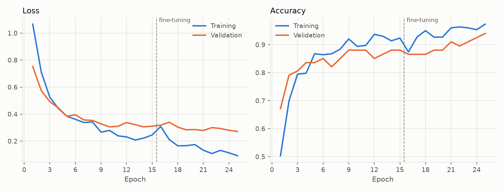
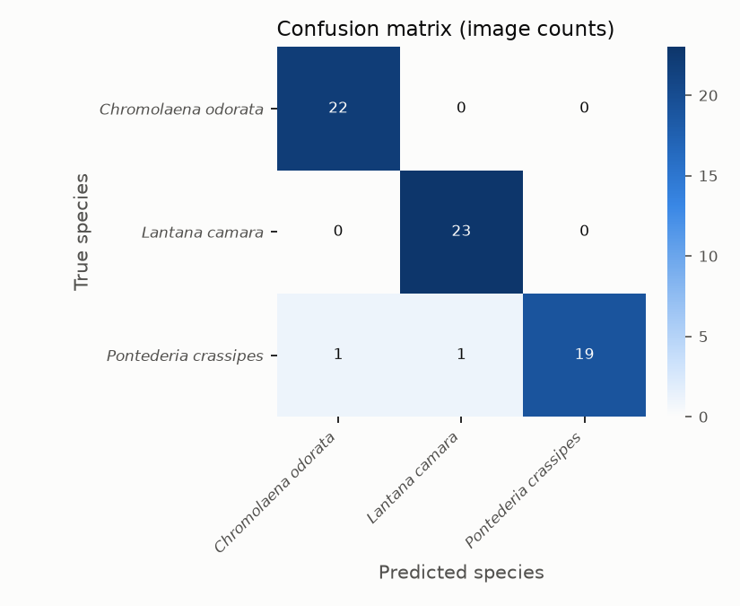
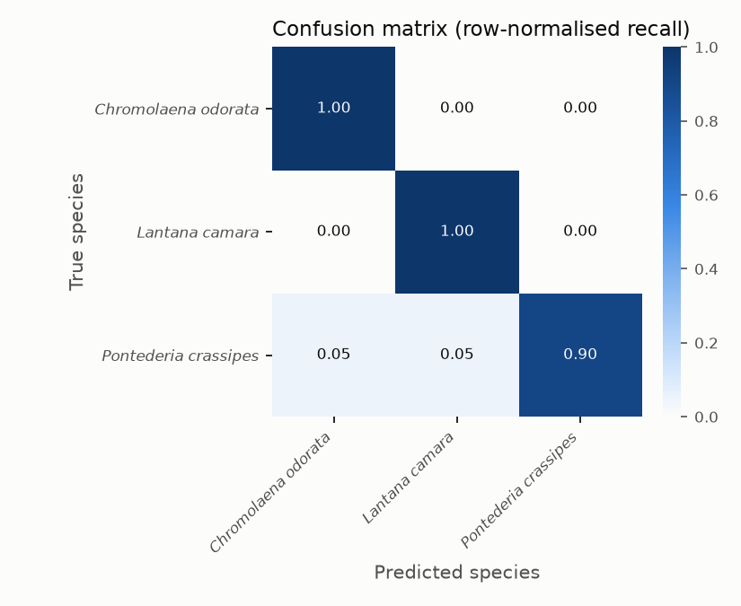
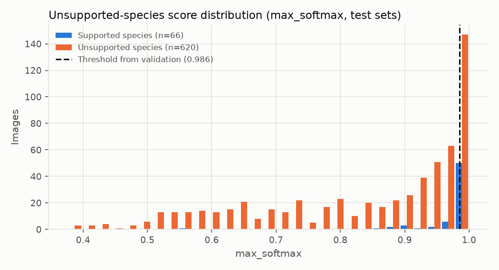
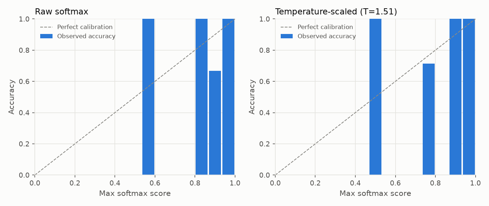

# Research Evaluation Report - run-20261104T093016Z-reviewed-v2

*Generated 2026-11-04T09:33:04+00:00 from run artifacts in `models/checkpoints/run-20261104T093016Z-reviewed-v2`. Dataset version `ds-20261104-8b1b716af8`. This model is a research candidate: it has not been deployed or activated in GeoFlora.*

## 1. Summary of observed results

- Classes: 3 (*Chromolaena odorata*, *Lantana camara*, *Pontederia crassipes*)
- Independent test images: 66 from 54 observation groups
- Test accuracy: **97.0%** (95% exact binomial CI 89.5% - 99.6%; observation-group bootstrap CI 92.6% - 100.0%)
- Macro F1: **0.969** (CI 0.925 - 1.000); weighted F1: 0.969
- Unsupported-species false acceptance: 100% without rejection (closed-set softmax); **19.2%** with the validation-selected threshold, at a supported-species acceptance rate of 71.2%. AUROC 0.844.
- Forward-pass latency (batch 1, median): 16.4 ms on CPU; model file 24.41 MB.

Targets such as a specific accuracy level are only met if the figures above show it on this independent test set.

## 2. Dataset sources and selection criteria

- Source(s): GBIF; source datasets: iNaturalist research-grade observations (435)
- Licenses used: CC-BY-NC-4.0: 392, CC-BY-4.0: 31, CC0-1.0: 12
- Country of record (top): PH: 374, US: 18, AR: 11, ZA: 5, IN: 4, BR: 3, AU: 3, TH: 3
- Selection criteria: still images with an allowed per-image license, basis of record ['HUMAN_OBSERVATION'], at most 1 image(s) per occurrence; quality checks (resolution, blur, exposure, aspect ratio); exact and perceptual duplicate removal; **photo-by-photo screening by a named non-botanist reviewer, starting from iNaturalist research-grade community identifications, with an AI-assisted pre-screen that flagged questionable photos for the reviewer's decision (not expert botanical verification)**.
- Label reviewer(s): Reyca de Alba (435 images)
- These photographs are external biodiversity records, not GeoFlora field observations.

## 3. Target species and ecological-status evidence

| Index | Species ID | Scientific name | Ecological status | Verification | Evidence |
|---|---|---|---|---|---|
| 0 | GF-SP-0001 | *Chromolaena odorata* | target_invasive | unverified | Recognised by the existing GeoFlora active CNN (client scope). Listed in IUCN SSC ISSG '100 of the World's Worst Invasive Alien Species' (Lowe et al. 2000) - global evidence only. Philippine-specific citation still to be supplied by the client/botanist. |
| 1 | GF-SP-0002 | *Lantana camara* | target_invasive | unverified | Recognised by the existing GeoFlora active CNN (client scope). Listed in IUCN SSC ISSG '100 of the World's Worst Invasive Alien Species' (Lowe et al. 2000) - global evidence only. Philippine-specific citation still to be supplied by the client/botanist. |
| 2 | GF-SP-0003 | *Pontederia crassipes* | target_invasive | unverified | Recognised by the existing GeoFlora active CNN (client scope). Listed in IUCN SSC ISSG '100 of the World's Worst Invasive Alien Species' as Eichhornia crassipes (Lowe et al. 2000) - global evidence only. Philippine-specific citation still to be supplied by the client/botanist. |

## 4. Images and independent observation groups per class

| Species | Train imgs / groups | Val imgs / groups | Test imgs / groups |
|---|---|---|---|
| *Chromolaena odorata* | 103 / 98 | 23 / 22 | 22 / 18 |
| *Lantana camara* | 104 / 95 | 23 / 23 | 23 / 20 |
| *Pontederia crassipes* | 95 / 90 | 21 / 19 | 21 / 16 |

## 5. Preprocessing

EXIF orientation applied, converted to RGB, re-encoded as JPEG (max side 1024 px), resized to 224x224 (bilinear, aspect ratio not preserved), float32 in [0, 255]; MobileNetV2 scaling to [-1, 1] inside the model.
Training augmentation: {'horizontal_flip': True, 'rotation': 0.08, 'zoom': 0.15, 'translation': 0.1, 'contrast': 0.2, 'brightness': 0.2}.

## 6. Training configuration and architecture

- Architecture: MobileNetV2, ImageNet-pretrained, alpha=1.0 -> GlobalAveragePooling -> Dropout(0.3) -> Dense(3, softmax). Parameters: 2,261,827.
- Phase 1 (frozen base): up to 15 epochs, Adam lr=0.001.
- Phase 2 (fine-tuning layers >= 100, BatchNorm frozen): up to 10 epochs, Adam lr=1e-05. Selected phase: **finetune** (lowest validation loss).
- Early stopping (patience 5), ReduceLROnPlateau, checkpointing on validation loss; batch size 16; seed 42; class weights: none.
- Epochs run: 25; training time 141.0 s.

## 7. Train / validation / test methodology

Images were partitioned by observation group (same occurrence, exact duplicates, perceptual near-duplicates [pHash Hamming <= 6], and same recorder on the same day) with target ratios {'train': 0.7, 'val': 0.15, 'test': 0.15}. Assignments are sticky across dataset versions so test images never enter training. Model selection and the unsupported-species threshold used validation data only; the test and unknown_test sets were used once, for this report.

## 8. Evaluation results (test set)

Validation (for reference): accuracy 94.0%, macro F1 0.941.

| Species | Precision | Recall | F1 | Support |
|---|---|---|---|---|
| *Chromolaena odorata* | 0.957 | 1.000 | 0.978 | 22 |
| *Lantana camara* | 0.958 | 1.000 | 0.979 | 23 |
| *Pontederia crassipes* | 1.000 | 0.905 | 0.950 | 21 |
| **Macro** | 0.972 | 0.968 | 0.969 | 66 |

Top 3 accuracy: 100.0%.

## 9. Confusion matrix

 

Most frequent confusions (true -> predicted): *Pontederia crassipes* -> *Lantana camara* (1); *Pontederia crassipes* -> *Chromolaena odorata* (1)

## 10. False-positive and false-negative analysis

| Species | TP | FN | FP | FN predicted as | FP true species | Mean score correct / incorrect |
|---|---|---|---|---|---|---|
| *Chromolaena odorata* | 22 | 0 | 1 | - | {'Pontederia crassipes': 1} | 0.958 / n/a |
| *Lantana camara* | 23 | 0 | 1 | - | {'Pontederia crassipes': 1} | 0.994 / n/a |
| *Pontederia crassipes* | 19 | 2 | 0 | {'Lantana camara': 1, 'Chromolaena odorata': 1} | - | 0.979 / 0.890 |

Misclassified images with attribution: `misclassified_test_images.csv`.

## 11. Unsupported-species evaluation

- Score: `max_softmax`; threshold strategy `youden` -> threshold 0.9855 (selected on validation (val + unknown_val); test sets not used).
- unknown_val species (threshold selection): Duranta erecta, Imperata cylindrica, Ipomoea aquatica, Limnocharis flava, Mimosa pudica, Pistia stratiotes
- unknown_test species (final evaluation): Ageratum conyzoides, Bidens pilosa, Hibiscus rosa-sinensis, Ixora coccinea, Lantana montevidensis, Mikania micrantha, Pontederia vaginalis
- Test: supported-species acceptance 71.2%, accuracy on accepted 100.0%; unsupported false acceptance 19.2% (n=620); AUROC 0.844.

| Unsupported species | Images | False acceptance (thresholded) | Labels assigned without rejection |
|---|---|---|---|
| *Ageratum conyzoides* | 143 | 17.5% | {'Chromolaena odorata': 124, 'Lantana camara': 12, 'Pontederia crassipes': 7} |
| *Bidens pilosa* | 18 | 22.2% | {'Chromolaena odorata': 8, 'Lantana camara': 8, 'Pontederia crassipes': 2} |
| *Hibiscus rosa-sinensis* | 19 | 5.3% | {'Lantana camara': 13, 'Pontederia crassipes': 4, 'Chromolaena odorata': 2} |
| *Ixora coccinea* | 20 | 25.0% | {'Lantana camara': 17, 'Pontederia crassipes': 2, 'Chromolaena odorata': 1} |
| *Lantana montevidensis* | 140 | 25.0% | {'Lantana camara': 96, 'Chromolaena odorata': 29, 'Pontederia crassipes': 15} |
| *Mikania micrantha* | 140 | 21.4% | {'Chromolaena odorata': 124, 'Pontederia crassipes': 11, 'Lantana camara': 5} |
| *Pontederia vaginalis* | 140 | 13.6% | {'Pontederia crassipes': 92, 'Chromolaena odorata': 48} |

Calibration: ECE 0.037 (raw softmax) and 0.045 after temperature scaling (T=1.51, fitted on validation). Softmax scores are model scores, not calibrated identification confidence.

## 12. Robustness and photographic conditions

Synthetic perturbations of the test images (these approximate, but are not, real lighting/angle/background changes):

| Perturbation | Accuracy | Macro F1 |
|---|---|---|
| none | 97.0% | 0.969 |
| darker_40pct | 95.5% | 0.954 |
| brighter_40pct | 97.0% | 0.969 |
| low_contrast | 90.9% | 0.910 |
| gaussian_blur | 81.8% | 0.801 |
| rotate_90 | 97.0% | 0.969 |
| jpeg_q20 | 93.9% | 0.937 |
| center_crop_60pct | 95.5% | 0.953 |

No reviewer condition tags (lighting, background, organ, growth stage) were available, so real-condition breakdowns were not computed.

## 13. Runtime and model size

Device CPU; batch-1 latency median 16.4 ms (p95 23.0 ms); batch-32 throughput 99.4 img/s; 2,261,827 parameters; `.keras` file 24.41 MB. Model forward pass only (excludes image decoding/resizing). Measured on this machine.

## 14. Model limitations (observed or inherent to this setup)

- Training and test images come from external biodiversity platforms; their photographers, devices and framing differ from GeoFlora users' photos, so field performance may differ from the figures above.
- Test-set size (66 images) bounds precision of the estimates; see the bootstrap confidence intervals.
- The model is closed-set: without the rejection threshold every unsupported plant receives a supported label.
- Softmax scores are not calibrated probabilities of a correct identification.
- 86.0% of the images used were recorded in the Philippines (country of record per source metadata).
- Ecological status is not yet verified with Philippine-specific evidence for: *Chromolaena odorata*, *Lantana camara*, *Pontederia crassipes*.
- At least one class has fewer than 30 test images; per-class metrics for those classes are highly uncertain.
- Aspect ratio is not preserved during resizing, which may distort plant morphology.

## 15. Reproducibility

- Run directory: `models/checkpoints/run-20261104T093016Z-reviewed-v2` (contains run_config.yaml, class_mapping.json, train/val/test image lists, history, logs).
- Dataset version `ds-20261104-8b1b716af8`; image lists for each split are stored with the run.
- Seed 42; deterministic ops: False.
- Environment: Python 3.11.9, TensorFlow 2.20.0, Keras 3.15.1, Windows-10-10.0.26200-SP0, GPUs: none.
- Re-run: `python scripts/train.py --config <run_config.yaml>` then `python scripts/evaluate.py --run <run_dir>`.

## 16. Proposed future improvements (not yet tested)

- Add targeted reviewed images that separate *Pontederia crassipes* from *Lantana camara* (1 confusions observed).
- Add targeted reviewed images that separate *Pontederia crassipes* from *Chromolaena odorata* (1 confusions observed).
- Collect GeoFlora-style field photographs from the Philippines (with consent and botanist verification) as an additional held-out test set.
- Expand the unsupported-species set with more look-alike and common non-target plants to tighten false-acceptance estimates.
- Evaluate alternative rejection methods (e.g. energy scores from logits, feature-space distance) on the same validation protocol.
- Ask reviewers to tag photographic conditions so that real-condition robustness can be measured.

