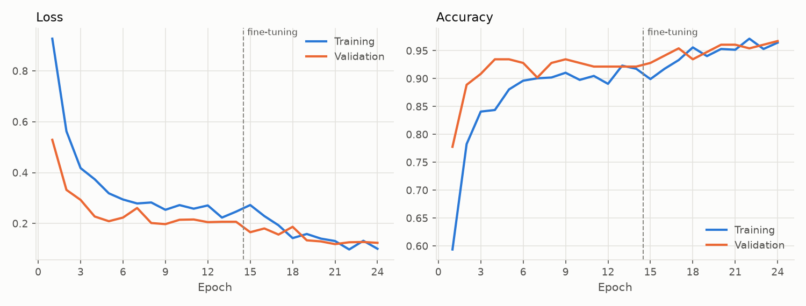
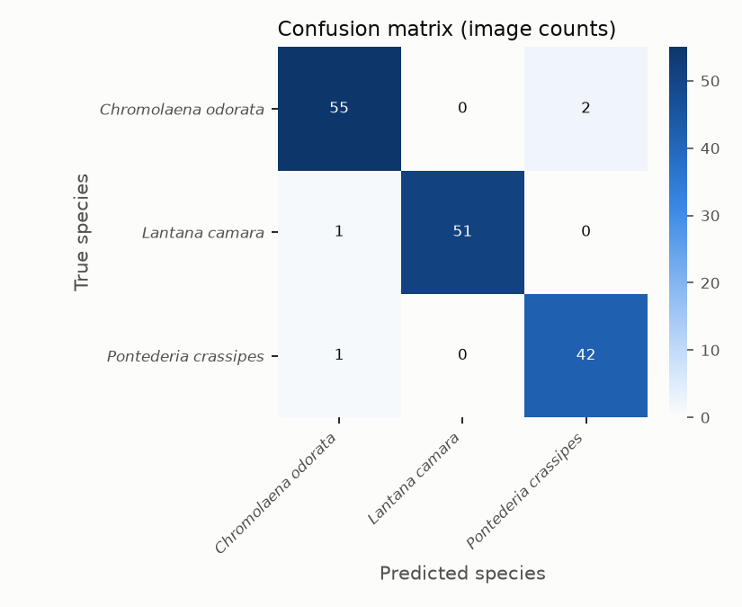
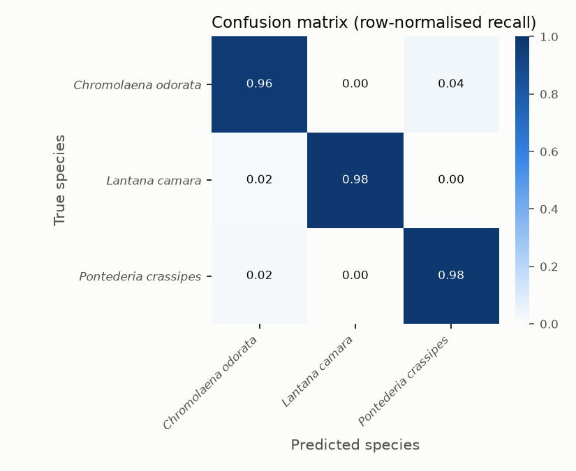
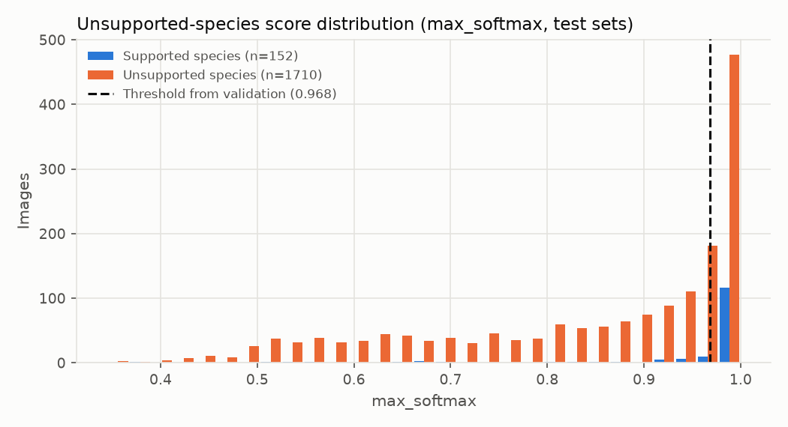
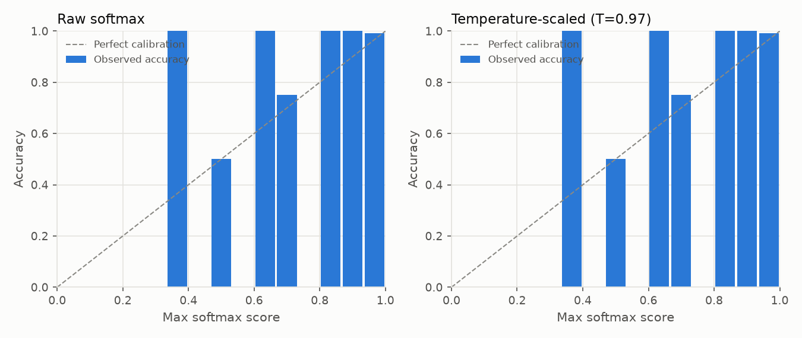

# Research Evaluation Report - run-20261104T151536Z-reviewed-v3

*Generated 2026-11-04T15:23:03+00:00 from run artifacts in `models/checkpoints/run-20261104T151536Z-reviewed-v3`. Dataset version `ds-20261104-ab732151f2`. This model is a research candidate: it has not been deployed or activated in GeoFlora.*

## 1. Summary of observed results

- Classes: 3 (*Chromolaena odorata*, *Lantana camara*, *Pontederia crassipes*)
- Independent test images: 152 from 134 observation groups
- Test accuracy: **97.4%** (95% exact binomial CI 93.4% - 99.3%; observation-group bootstrap CI 94.7% - 99.4%)
- Macro F1: **0.974** (CI 0.946 - 0.994); weighted F1: 0.974
- Unsupported-species false acceptance: 100% without rejection (closed-set softmax); **33.2%** with the validation-selected threshold, at a supported-species acceptance rate of 80.3%. AUROC 0.821.
- Forward-pass latency (batch 1, median): 24.4 ms on CPU; model file 24.41 MB.

Targets such as a specific accuracy level are only met if the figures above show it on this independent test set.

## 2. Dataset sources and selection criteria

- Source(s): GBIF; source datasets: iNaturalist research-grade observations (1009)
- Licenses used: CC-BY-NC-4.0: 889, CC-BY-4.0: 91, CC0-1.0: 29
- Country of record (top): PH: 512, US: 99, IN: 56, AU: 55, TW: 52, AR: 36, ZA: 29, TH: 22
- Selection criteria: still images with an allowed per-image license, basis of record ['HUMAN_OBSERVATION'], at most 1 image(s) per occurrence; quality checks (resolution, blur, exposure, aspect ratio); exact and perceptual duplicate removal; **photo-by-photo screening by a named non-botanist reviewer, starting from iNaturalist research-grade community identifications, with an AI-assisted pre-screen that flagged questionable photos for the reviewer's decision (not expert botanical verification)**.
- Label reviewer(s): Reyca de Alba (1009 images)
- These photographs are external biodiversity records, not GeoFlora field observations.

## 3. Target species and ecological-status evidence

| Index | Species ID | Scientific name | Ecological status | Verification | Evidence |
|---|---|---|---|---|---|
| 0 | GF-SP-0001 | *Chromolaena odorata* | target_invasive | unverified | Recognised by the existing GeoFlora active CNN (client scope). Listed in IUCN SSC ISSG '100 of the World's Worst Invasive Alien Species' (Lowe et al. 2000) - global evidence only. Philippine-specific citation still to be supplied by the client/botanist. / Philippines: DENR-BMB National Invasive Species Strategy and Action Plan (NISSAP) 2020-2030, p. 9 (most noxious invasive plants) and Box 2.1 (https://www.philchm.ph/wp-content/uploads/2024/01/NISSAP-2020-2030.pdf). Citation added 2026-11-04; not yet checked by a named verifier. |
| 1 | GF-SP-0002 | *Lantana camara* | target_invasive | unverified | Recognised by the existing GeoFlora active CNN (client scope). Listed in IUCN SSC ISSG '100 of the World's Worst Invasive Alien Species' (Lowe et al. 2000) - global evidence only. Philippine-specific citation still to be supplied by the client/botanist. / Philippines: DENR-BMB National Invasive Species Strategy and Action Plan (NISSAP) 2020-2030, p. 9 and Box 2.1 (https://www.philchm.ph/wp-content/uploads/2024/01/NISSAP-2020-2030.pdf). Citation added 2026-11-04; not yet checked by a named verifier. |
| 2 | GF-SP-0003 | *Pontederia crassipes* | target_invasive | unverified | Recognised by the existing GeoFlora active CNN (client scope). Listed in IUCN SSC ISSG '100 of the World's Worst Invasive Alien Species' as Eichhornia crassipes (Lowe et al. 2000) - global evidence only. Philippine-specific citation still to be supplied by the client/botanist. / Philippines: DENR-BMB National Invasive Species Strategy and Action Plan (NISSAP) 2020-2030, p. 9 and Box 2.1 (as Eichhornia crassipes) (https://www.philchm.ph/wp-content/uploads/2024/01/NISSAP-2020-2030.pdf). Citation added 2026-11-04; not yet checked by a named verifier. |

## 4. Images and independent observation groups per class

| Species | Train imgs / groups | Val imgs / groups | Test imgs / groups |
|---|---|---|---|
| *Chromolaena odorata* | 262 / 245 | 57 / 52 | 57 / 52 |
| *Lantana camara* | 243 / 218 | 53 / 47 | 52 / 46 |
| *Pontederia crassipes* | 199 / 188 | 43 / 40 | 43 / 36 |

## 5. Preprocessing

EXIF orientation applied, converted to RGB, re-encoded as JPEG (max side 1024 px), resized to 224x224 (bilinear, aspect ratio not preserved), float32 in [0, 255]; MobileNetV2 scaling to [-1, 1] inside the model.
Training augmentation: {'horizontal_flip': True, 'rotation': 0.08, 'zoom': 0.15, 'translation': 0.1, 'contrast': 0.2, 'brightness': 0.2}.

## 6. Training configuration and architecture

- Architecture: MobileNetV2, ImageNet-pretrained, alpha=1.0 -> GlobalAveragePooling -> Dropout(0.3) -> Dense(3, softmax). Parameters: 2,261,827.
- Phase 1 (frozen base): up to 15 epochs, Adam lr=0.001.
- Phase 2 (fine-tuning layers >= 100, BatchNorm frozen): up to 10 epochs, Adam lr=1e-05. Selected phase: **finetune** (lowest validation loss).
- Early stopping (patience 5), ReduceLROnPlateau, checkpointing on validation loss; batch size 16; seed 42; class weights: none.
- Epochs run: 24; training time 382.7 s.

## 7. Train / validation / test methodology

Images were partitioned by observation group (same occurrence, exact duplicates, perceptual near-duplicates [pHash Hamming <= 6], and same recorder on the same day) with target ratios {'train': 0.7, 'val': 0.15, 'test': 0.15}. Assignments are sticky across dataset versions so test images never enter training. Model selection and the unsupported-species threshold used validation data only; the test and unknown_test sets were used once, for this report.

## 8. Evaluation results (test set)

Validation (for reference): accuracy 96.1%, macro F1 0.962.

| Species | Precision | Recall | F1 | Support |
|---|---|---|---|---|
| *Chromolaena odorata* | 0.965 | 0.965 | 0.965 | 57 |
| *Lantana camara* | 1.000 | 0.981 | 0.990 | 52 |
| *Pontederia crassipes* | 0.955 | 0.977 | 0.966 | 43 |
| **Macro** | 0.973 | 0.974 | 0.974 | 152 |

Top 3 accuracy: 100.0%.

## 9. Confusion matrix

 

Most frequent confusions (true -> predicted): *Chromolaena odorata* -> *Pontederia crassipes* (2); *Pontederia crassipes* -> *Chromolaena odorata* (1); *Lantana camara* -> *Chromolaena odorata* (1)

## 10. False-positive and false-negative analysis

| Species | TP | FN | FP | FN predicted as | FP true species | Mean score correct / incorrect |
|---|---|---|---|---|---|---|
| *Chromolaena odorata* | 55 | 2 | 2 | {'Pontederia crassipes': 2} | {'Lantana camara': 1, 'Pontederia crassipes': 1} | 0.961 / 0.833 |
| *Lantana camara* | 51 | 1 | 0 | {'Chromolaena odorata': 1} | - | 0.980 / 0.505 |
| *Pontederia crassipes* | 42 | 1 | 2 | {'Chromolaena odorata': 1} | {'Chromolaena odorata': 2} | 0.962 / 0.554 |

Misclassified images with attribution: `misclassified_test_images.csv`.

## 11. Unsupported-species evaluation

- Score: `max_softmax`; threshold strategy `youden` -> threshold 0.9683 (selected on validation (val + unknown_val); test sets not used).
- unknown_val species (threshold selection): Duranta erecta, Imperata cylindrica, Ipomoea aquatica, Limnocharis flava, Mimosa pudica, Pistia stratiotes
- unknown_test species (final evaluation): Ageratum conyzoides, Bidens pilosa, Hibiscus rosa-sinensis, Ixora coccinea, Lantana montevidensis, Mikania micrantha, Pontederia vaginalis
- Test: supported-species acceptance 80.3%, accuracy on accepted 99.2%; unsupported false acceptance 33.2% (n=1710); AUROC 0.821.

| Unsupported species | Images | False acceptance (thresholded) | Labels assigned without rejection |
|---|---|---|---|
| *Ageratum conyzoides* | 368 | 38.9% | {'Chromolaena odorata': 319, 'Lantana camara': 30, 'Pontederia crassipes': 19} |
| *Bidens pilosa* | 121 | 21.5% | {'Chromolaena odorata': 57, 'Lantana camara': 49, 'Pontederia crassipes': 15} |
| *Hibiscus rosa-sinensis* | 140 | 9.3% | {'Lantana camara': 59, 'Pontederia crassipes': 43, 'Chromolaena odorata': 38} |
| *Ixora coccinea* | 135 | 28.1% | {'Lantana camara': 90, 'Pontederia crassipes': 36, 'Chromolaena odorata': 9} |
| *Lantana montevidensis* | 307 | 34.9% | {'Lantana camara': 221, 'Chromolaena odorata': 64, 'Pontederia crassipes': 22} |
| *Mikania micrantha* | 337 | 47.5% | {'Chromolaena odorata': 310, 'Pontederia crassipes': 16, 'Lantana camara': 11} |
| *Pontederia vaginalis* | 302 | 26.5% | {'Pontederia crassipes': 203, 'Chromolaena odorata': 96, 'Lantana camara': 3} |

Calibration: ECE 0.021 (raw softmax) and 0.020 after temperature scaling (T=0.97, fitted on validation). Softmax scores are model scores, not calibrated identification confidence.

## 12. Robustness and photographic conditions

Synthetic perturbations of the test images (these approximate, but are not, real lighting/angle/background changes):

| Perturbation | Accuracy | Macro F1 |
|---|---|---|
| none | 97.4% | 0.974 |
| darker_40pct | 93.4% | 0.935 |
| brighter_40pct | 96.1% | 0.960 |
| low_contrast | 86.8% | 0.868 |
| gaussian_blur | 77.0% | 0.724 |
| rotate_90 | 96.1% | 0.961 |
| jpeg_q20 | 92.8% | 0.928 |
| center_crop_60pct | 94.1% | 0.938 |

No reviewer condition tags (lighting, background, organ, growth stage) were available, so real-condition breakdowns were not computed.

## 13. Runtime and model size

Device CPU; batch-1 latency median 24.4 ms (p95 31.5 ms); batch-32 throughput 82.2 img/s; 2,261,827 parameters; `.keras` file 24.41 MB. Model forward pass only (excludes image decoding/resizing). Measured on this machine.

## 14. Model limitations (observed or inherent to this setup)

- Training and test images come from external biodiversity platforms; their photographers, devices and framing differ from GeoFlora users' photos, so field performance may differ from the figures above.
- Test-set size (152 images) bounds precision of the estimates; see the bootstrap confidence intervals.
- The model is closed-set: without the rejection threshold every unsupported plant receives a supported label.
- Softmax scores are not calibrated probabilities of a correct identification.
- 50.7% of the images used were recorded in the Philippines (country of record per source metadata).
- Ecological status is not yet verified with Philippine-specific evidence for: *Chromolaena odorata*, *Lantana camara*, *Pontederia crassipes*.
- Aspect ratio is not preserved during resizing, which may distort plant morphology.

## 15. Reproducibility

- Run directory: `models/checkpoints/run-20261104T151536Z-reviewed-v3` (contains run_config.yaml, class_mapping.json, train/val/test image lists, history, logs).
- Dataset version `ds-20261104-ab732151f2`; image lists for each split are stored with the run.
- Seed 42; deterministic ops: False.
- Environment: Python 3.11.9, TensorFlow 2.20.0, Keras 3.15.1, Windows-10-10.0.26200-SP0, GPUs: none.
- Re-run: `python scripts/train.py --config <run_config.yaml>` then `python scripts/evaluate.py --run <run_dir>`.

## 16. Proposed future improvements (not yet tested)

- Add targeted reviewed images that separate *Chromolaena odorata* from *Pontederia crassipes* (2 confusions observed).
- Add targeted reviewed images that separate *Pontederia crassipes* from *Chromolaena odorata* (1 confusions observed).
- Add targeted reviewed images that separate *Lantana camara* from *Chromolaena odorata* (1 confusions observed).
- Collect GeoFlora-style field photographs from the Philippines (with consent and botanist verification) as an additional held-out test set.
- Expand the unsupported-species set with more look-alike and common non-target plants to tighten false-acceptance estimates.
- Evaluate alternative rejection methods (e.g. energy scores from logits, feature-space distance) on the same validation protocol.
- Ask reviewers to tag photographic conditions so that real-condition robustness can be measured.

