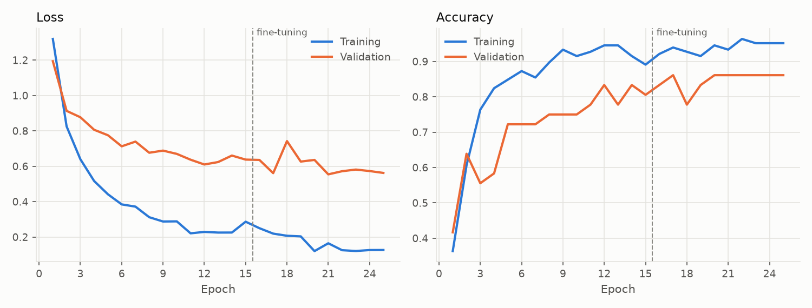
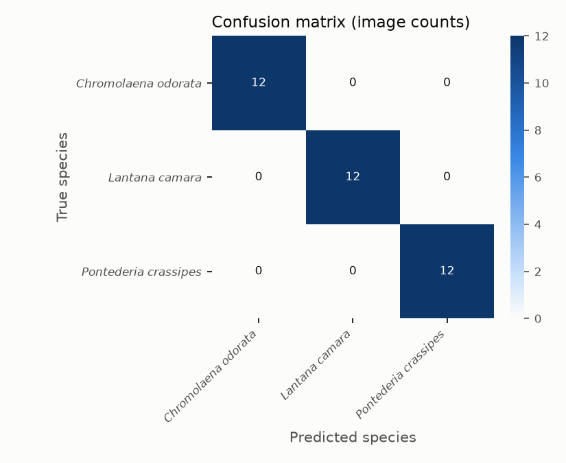
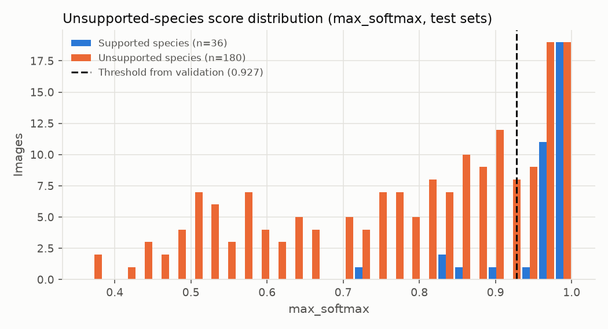
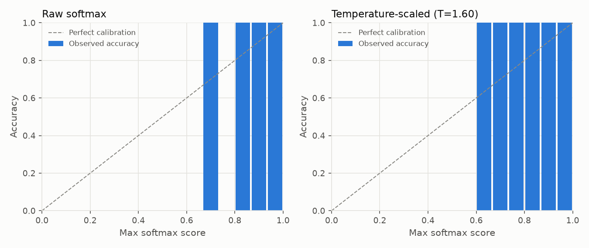

# Research Evaluation Report - run-20261101T091305Z-pilot

*Generated 2026-11-01T09:15:41+00:00 from run artifacts in `models/checkpoints/provisional/run-20261101T091305Z-pilot`. Dataset version `ds-20261101-c9f7f87fef`. This model is a research candidate: it has not been deployed or activated in GeoFlora.*

> **PROVISIONAL PILOT - NOT A RESEARCH RESULT.** Labels are unreviewed identifications from the source platform (iNaturalist research grade = community agreement), not botanical verification. These figures may not be reported as GeoFlora model performance, and this run cannot be exported. They only indicate how the pipeline behaves on real photographs while botanical review is pending.

## 1. Summary of observed results

- Classes: 3 (*Chromolaena odorata*, *Lantana camara*, *Pontederia crassipes*)
- Independent test images: 36 from 35 observation groups
- Test accuracy: **100.0%** (95% exact binomial CI 90.3% - 100.0%; observation-group bootstrap CI 100.0% - 100.0%)
- Macro F1: **1.000** (CI 1.000 - 1.000); weighted F1: 1.000
- Unsupported-species false acceptance: 100% without rejection (closed-set softmax); **27.2%** with the validation-selected threshold, at a supported-species acceptance rate of 86.1%. AUROC 0.865.
- Forward-pass latency (batch 1, median): 18.3 ms on CPU; model file 24.41 MB.

Targets such as a specific accuracy level are only met if the figures above show it on this independent test set.

## 2. Dataset sources and selection criteria

- Source(s): GBIF; source datasets: iNaturalist research-grade observations (237)
- Licenses used: CC-BY-NC-4.0: 219, CC-BY-4.0: 17, CC0-1.0: 1
- Country of record (top): PH: 237
- Selection criteria: still images with an allowed per-image license, basis of record ['HUMAN_OBSERVATION'], at most 1 image(s) per occurrence; quality checks (resolution, blur, exposure, aspect ratio); exact and perceptual duplicate removal; **PROVISIONAL: unreviewed source identifications (no botanical review)**.
- These photographs are external biodiversity records, not GeoFlora field observations.

## 3. Target species and ecological-status evidence

| Index | Species ID | Scientific name | Ecological status | Verification | Evidence |
|---|---|---|---|---|---|
| 0 | GF-SP-0001 | *Chromolaena odorata* | target_invasive | unverified | Recognised by the existing GeoFlora active CNN (client scope). Listed in IUCN SSC ISSG '100 of the World's Worst Invasive Alien Species' (Lowe et al. 2000) - global evidence only. Philippine-specific citation still to be supplied by the client/botanist. |
| 1 | GF-SP-0002 | *Lantana camara* | target_invasive | unverified | Recognised by the existing GeoFlora active CNN (client scope). Listed in IUCN SSC ISSG '100 of the World's Worst Invasive Alien Species' (Lowe et al. 2000) - global evidence only. Philippine-specific citation still to be supplied by the client/botanist. |
| 2 | GF-SP-0003 | *Pontederia crassipes* | target_invasive | unverified | Recognised by the existing GeoFlora active CNN (client scope). Listed in IUCN SSC ISSG '100 of the World's Worst Invasive Alien Species' as Eichhornia crassipes (Lowe et al. 2000) - global evidence only. Philippine-specific citation still to be supplied by the client/botanist. |

## 4. Images and independent observation groups per class

| Species | Train imgs / groups | Val imgs / groups | Test imgs / groups |
|---|---|---|---|
| *Chromolaena odorata* | 55 / 51 | 12 / 12 | 12 / 12 |
| *Lantana camara* | 56 / 54 | 12 / 12 | 12 / 11 |
| *Pontederia crassipes* | 54 / 50 | 12 / 12 | 12 / 12 |

## 5. Preprocessing

EXIF orientation applied, converted to RGB, re-encoded as JPEG (max side 1024 px), resized to 224x224 (bilinear, aspect ratio not preserved), float32 in [0, 255]; MobileNetV2 scaling to [-1, 1] inside the model.
Training augmentation: {'horizontal_flip': True, 'rotation': 0.08, 'zoom': 0.15, 'translation': 0.1, 'contrast': 0.2, 'brightness': 0.2}.

## 6. Training configuration and architecture

- Architecture: MobileNetV2, ImageNet-pretrained, alpha=1.0 -> GlobalAveragePooling -> Dropout(0.3) -> Dense(3, softmax). Parameters: 2,261,827.
- Phase 1 (frozen base): up to 15 epochs, Adam lr=0.001.
- Phase 2 (fine-tuning layers >= 100, BatchNorm frozen): up to 10 epochs, Adam lr=1e-05. Selected phase: **finetune** (lowest validation loss).
- Early stopping (patience 5), ReduceLROnPlateau, checkpointing on validation loss; batch size 16; seed 42; class weights: none.
- Epochs run: 25; training time 71.3 s.

## 7. Train / validation / test methodology

Images were partitioned by observation group (same occurrence, exact duplicates, perceptual near-duplicates [pHash Hamming <= 6], and same recorder on the same day) with target ratios {'train': 0.7, 'val': 0.15, 'test': 0.15}. Assignments are sticky across dataset versions so test images never enter training. Model selection and the unsupported-species threshold used validation data only; the test and unknown_test sets were used once, for this report.

## 8. Evaluation results (test set)

Validation (for reference): accuracy 86.1%, macro F1 0.862.

| Species | Precision | Recall | F1 | Support |
|---|---|---|---|---|
| *Chromolaena odorata* | 1.000 | 1.000 | 1.000 | 12 |
| *Lantana camara* | 1.000 | 1.000 | 1.000 | 12 |
| *Pontederia crassipes* | 1.000 | 1.000 | 1.000 | 12 |
| **Macro** | 1.000 | 1.000 | 1.000 | 36 |

Top 3 accuracy: 100.0%.

## 9. Confusion matrix

 

No confusions were observed on the test set.

## 10. False-positive and false-negative analysis

| Species | TP | FN | FP | FN predicted as | FP true species | Mean score correct / incorrect |
|---|---|---|---|---|---|---|
| *Chromolaena odorata* | 12 | 0 | 0 | - | - | 0.935 / n/a |
| *Lantana camara* | 12 | 0 | 0 | - | - | 0.971 / n/a |
| *Pontederia crassipes* | 12 | 0 | 0 | - | - | 0.982 / n/a |

Misclassified images with attribution: `misclassified_test_images.csv`.

## 11. Unsupported-species evaluation

- Score: `max_softmax`; threshold strategy `youden` -> threshold 0.9274 (selected on validation (val + unknown_val); test sets not used).
- unknown_val species (threshold selection): Duranta erecta, Imperata cylindrica, Ipomoea aquatica, Limnocharis flava, Mimosa pudica, Pistia stratiotes
- unknown_test species (final evaluation): Ageratum conyzoides, Bidens pilosa, Hibiscus rosa-sinensis, Ixora coccinea, Lantana montevidensis, Mikania micrantha, Pontederia vaginalis
- Test: supported-species acceptance 86.1%, accuracy on accepted 100.0%; unsupported false acceptance 27.2% (n=180); AUROC 0.865.

| Unsupported species | Images | False acceptance (thresholded) | Labels assigned without rejection |
|---|---|---|---|
| *Ageratum conyzoides* | 30 | 30.0% | {'Chromolaena odorata': 27, 'Lantana camara': 2, 'Pontederia crassipes': 1} |
| *Bidens pilosa* | 20 | 25.0% | {'Chromolaena odorata': 10, 'Lantana camara': 7, 'Pontederia crassipes': 3} |
| *Hibiscus rosa-sinensis* | 20 | 20.0% | {'Lantana camara': 17, 'Chromolaena odorata': 2, 'Pontederia crassipes': 1} |
| *Ixora coccinea* | 20 | 30.0% | {'Lantana camara': 17, 'Pontederia crassipes': 2, 'Chromolaena odorata': 1} |
| *Lantana montevidensis* | 30 | 16.7% | {'Lantana camara': 16, 'Chromolaena odorata': 10, 'Pontederia crassipes': 4} |
| *Mikania micrantha* | 30 | 43.3% | {'Chromolaena odorata': 25, 'Pontederia crassipes': 4, 'Lantana camara': 1} |
| *Pontederia vaginalis* | 30 | 23.3% | {'Pontederia crassipes': 22, 'Chromolaena odorata': 8} |

Calibration: ECE 0.038 (raw softmax) and 0.100 after temperature scaling (T=1.60, fitted on validation). Softmax scores are model scores, not calibrated identification confidence.

## 12. Robustness and photographic conditions

Synthetic perturbations of the test images (these approximate, but are not, real lighting/angle/background changes):

| Perturbation | Accuracy | Macro F1 |
|---|---|---|
| none | 100.0% | 1.000 |
| darker_40pct | 100.0% | 1.000 |
| brighter_40pct | 97.2% | 0.972 |
| low_contrast | 97.2% | 0.972 |
| gaussian_blur | 83.3% | 0.831 |
| rotate_90 | 100.0% | 1.000 |
| jpeg_q20 | 94.4% | 0.944 |
| center_crop_60pct | 100.0% | 1.000 |

No reviewer condition tags (lighting, background, organ, growth stage) were available, so real-condition breakdowns were not computed.

## 13. Runtime and model size

Device CPU; batch-1 latency median 18.3 ms (p95 21.3 ms); batch-32 throughput 107.9 img/s; 2,261,827 parameters; `.keras` file 24.41 MB. Model forward pass only (excludes image decoding/resizing). Measured on this machine.

## 14. Model limitations (observed or inherent to this setup)

- Training and test images come from external biodiversity platforms; their photographers, devices and framing differ from GeoFlora users' photos, so field performance may differ from the figures above.
- Test-set size (36 images) bounds precision of the estimates; see the bootstrap confidence intervals.
- The model is closed-set: without the rejection threshold every unsupported plant receives a supported label.
- Softmax scores are not calibrated probabilities of a correct identification.
- 100.0% of the images used were recorded in the Philippines (country of record per source metadata).
- Ecological status is not yet verified with Philippine-specific evidence for: *Chromolaena odorata*, *Lantana camara*, *Pontederia crassipes*.
- At least one class has fewer than 30 test images; per-class metrics for those classes are highly uncertain.
- Validation accuracy (86.1%) and test accuracy (100.0%) differ by >= 10 points, which indicates high sampling variance at this data size; neither figure alone is a reliable performance estimate.
- Aspect ratio is not preserved during resizing, which may distort plant morphology.

## 15. Reproducibility

- Run directory: `models/checkpoints/provisional/run-20261101T091305Z-pilot` (contains run_config.yaml, class_mapping.json, train/val/test image lists, history, logs).
- Dataset version `ds-20261101-c9f7f87fef`; image lists for each split are stored with the run.
- Seed 42; deterministic ops: False.
- Environment: Python 3.11.9, TensorFlow 2.20.0, Keras 3.15.1, Windows-10-10.0.26200-SP0, GPUs: none.
- Re-run: `python scripts/train.py --config <run_config.yaml>` then `python scripts/evaluate.py --run <run_dir>`.

## 16. Proposed future improvements (not yet tested)

- Collect GeoFlora-style field photographs from the Philippines (with consent and botanist verification) as an additional held-out test set.
- Expand the unsupported-species set with more look-alike and common non-target plants to tighten false-acceptance estimates.
- Evaluate alternative rejection methods (e.g. energy scores from logits, feature-space distance) on the same validation protocol.
- Ask reviewers to tag photographic conditions so that real-condition robustness can be measured.

